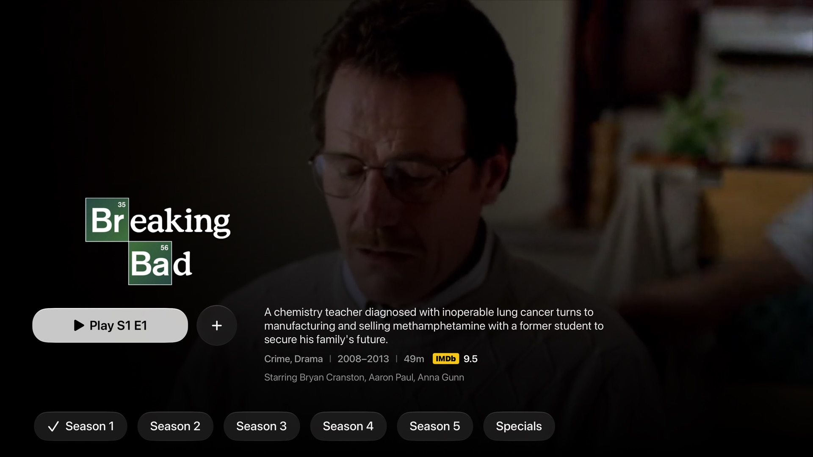
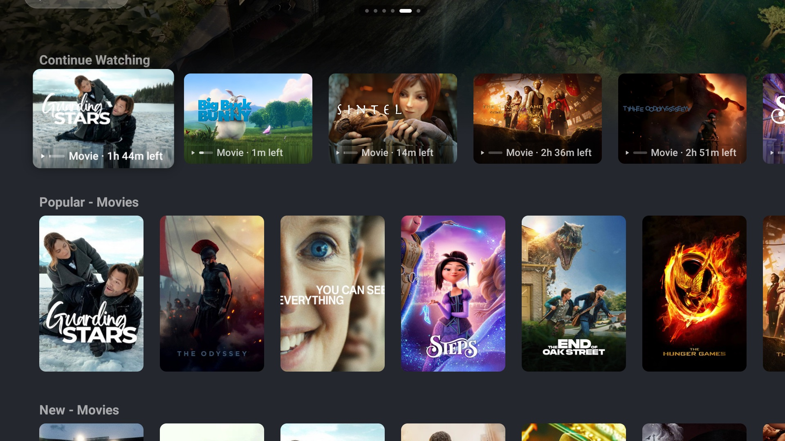
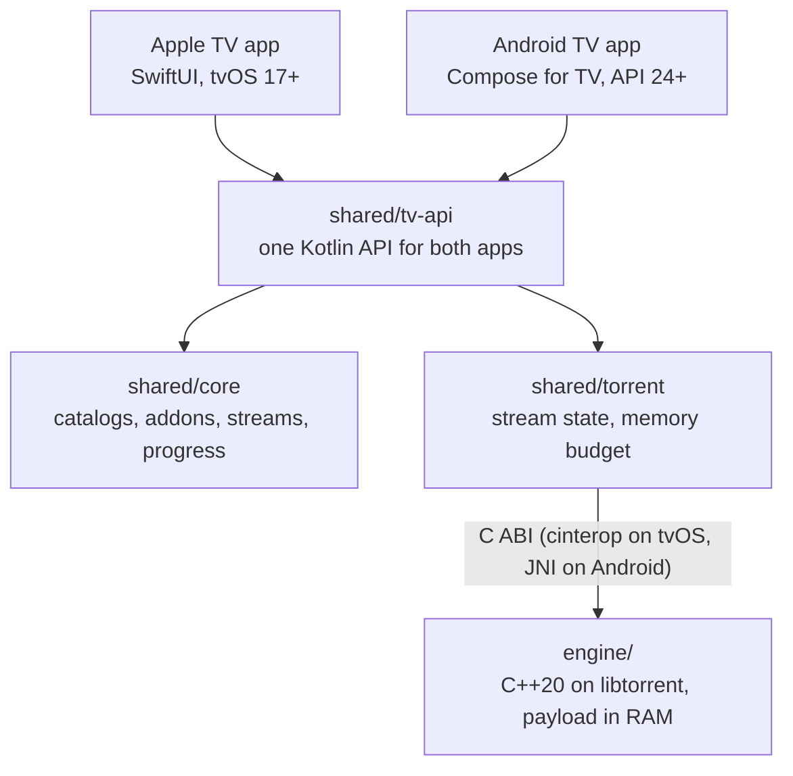

# Movies

A streaming app for the living room, built natively twice: **Apple TV** (SwiftUI) and
**Android TV** (Compose for TV). Both apps run one Kotlin core for catalogs, addons, streams and
watch progress, and one torrent engine written here in C++ that streams straight from RAM.

<p align="center">
  
</p>

| | |
|---|---|
|  |  |
|  |  |

Apple TV: Apple TV 4K simulator (tvOS 27.2), current `main`; the Streams shot uses the debug
fixture rows. Android TV: release `box` build on a TCL TV (Android 11, 1920x1080).

## What it does

- **Home**: full bleed hero with title logos, Continue Watching with Next Up, catalog rows from
  the installed addons. On Apple TV the hero fades into the title's trailer.
- **Details**: logo hero, play or resume, season tabs and episode cards, cast and crew,
  information.
- **Streams**: every addon's sources grouped and ranked, with resolution, HDR, Dolby Vision,
  Atmos, codec and size read from the release name. Direct links and torrents in one list.
- **Player**: Apple TV plays MP4, MOV and HLS in AVPlayer and everything else (MKV, WebM, AVI)
  in mpv; Android TV plays everything in ExoPlayer. Audio and subtitle menus, online subtitles,
  scrubbing with a preview on the bar, resume where you left off.
- **Torrents**: magnet in, video out over a loopback HTTP gateway, payload kept in RAM and
  never written to flash.
- **Search**, **Library** and **mark as watched** (Apple TV), **Addons** with install from your
  phone by QR code, **Settings**, and a Top Shelf extension on Apple TV.

## How it is built



- **Logic once, UI twice.** Anything that is not pixels or a platform API is Kotlin in
  `shared/`, compiled for tvOS as a framework and for Android as a library. Each app draws with
  its own system components; Android files mirror the Swift file names, so a feature is easy to
  find on both sides.
- **Apple TV is the spec.** Sizes, type and motion are measured on Apple's own TV app
  (`docs/tv-look-spec.md`) and ported to Android at `dp = pt / 2`.
- **Our own torrent engine.** One `core::Engine` composes a libtorrent session, a memory payload
  store, a piece planner and a Range capable HTTP gateway. libtorrent writes into the store and
  the gateway reads from it without a copy. Pieces far from the playhead are dropped through our
  `drop_pieces` libtorrent patch, so a 90 GB remux plays inside a fixed cap (512 MiB on Apple TV,
  up to 192 MiB on a 1.9 GB Android box). The ABI never calls back into the host and never
  throws: hosts poll.
- **Tuned for a cheap box.** The Android test box is a 32-bit Mi Box with a fill rate bound GPU.
  No full screen gradients, no runtime blur, no stacked translucent layers: each was measured
  with perfetto before it went (a full screen gradient alone cost 6.5 ms of a 16.7 ms frame).

## Measured

Android TV, release `box` build on a Mi Box (Android 14, armeabi-v7a, 1.9 GB RAM), against the
previous Android TV app on the same box, with `box/perf/measure.sh`. The scenario keeps the same
shape (scroll Home, open Details, Back) but is not identical, so read these as a reference.

| | Previous app | Now |
|---|---|---|
| Cold start (`TotalTime`) | 1,038 to 1,270 ms | **395 to 409 ms** |
| Memory (PSS) | 328 to 355 MB | **96 to 103 MB** |
| Details jank | 7.7 to 8.3% | **3.4 to 4.0%** |
| Home scroll, median frame | 21 ms | 24 to 31 ms (target 16 ms, work in progress) |

Torrent start, measured from a Mac against a real swarm (4K film, 16 MiB pieces, time from
metadata to the first whole piece): libtorrent defaults 45 s to over 90 s; our session settings
8 to 30 s, median 14 s.

## Status

| Area | Apple TV | Android TV |
|---|---|---|
| Home, Details, Streams, Search, Addons, Settings | Done | Done |
| Player | AVPlayer and mpv | ExoPlayer |
| Torrents on our engine | Plays and seeks on an Apple TV 4K | Runs on the engine; first frame, memory and seeks on the box not verified yet |
| Library, mark as watched | Done | Next |
| Trailers in the hero | Done | Off on the box by design (GPU budget) |
| Next episode, skip intro, related titles, catalog order, subtitle style | Planned | After Apple TV |
| Box hardening (baseline profile, jank pass) | | Planned |

Plans and acceptance criteria: `docs/android-tv-rebuild.md` (apps) and `docs/engine-rebuild.md`
(engine).

## Layout

```
apps/
  apple-tv/            Apple TV app. project.yml -> NuvioTv.xcodeproj (XcodeGen)
  android-tv/          Android TV app, a project of the shared/ Gradle build
    box/               install, perf and brand scripts for the Android TV box
    box/legal-test-addon/  an addon of openly licensed torrent films for tests
    third_party/       source of the FFmpeg audio decoder AAR (GPL)
shared/                Kotlin Multiplatform Gradle build (AGP 9.2, Kotlin 2.4)
  core/                shared logic: models, addons, streams, progress, sync
  tv-api/              the API both apps call
  apple-tv-bridge/     builds core and tv-api for tvOS as a framework
  android-tv-bridge/   builds core and tv-api for Android, TvRuntime.init
  torrent/             Kotlin API of the torrent engine
engine/                the torrent engine (C++20, libtorrent, payload in RAM)
docs/                  plans that span both apps, showcase/ screenshots
Makefile               one entry point for every build
```

## Build

`make help` lists every target. The common ones (macOS, JDK 17 from Homebrew):

```bash
make apple-tv-sim                            # Apple TV app for the simulator
make apple-tv-install APPLE_TEAM=<team id> APPLE_TV_DEVICE=<devicectl id>
make android-tv                              # Android TV box APK (R8, armeabi-v7a)
ANDROID_SERIAL=<ip>:5555 make box-install    # install it on the box with its baseline profile
make engine-next engine-test                 # torrent engine: xcframework, unit tests
make engine-android                          # torrent engine for Android: libmovies_engine.so per ABI
make check                                   # shared, engine and Android TV tests, lint, init check
make format                                  # ktlint --format on the Kotlin sources
```

- One toolchain: Gradle 9.4.1, AGP 9.2, Kotlin 2.4.10, Android NDK 29.0.14206865.
- The first engine build downloads Boost 1.86 and libtorrent 2.0.12 (pinned by SHA-256) into
  `engine/.deps` and compiles libtorrent per slice or ABI, a minute or two each.
- `make android-tv` builds the engine first; an Android build without `libmovies_engine.so`
  fails on purpose.
- `shared/local.properties` holds local settings (signing values, `ABIS`) and is not committed.
- Kotlin style is ktlint 1.8.0 (`scripts/ktlint` fetches it and checks its hash) with the rules
  in `.editorconfig`.

## License

GNU General Public License v3.0, see `LICENSE`. `shared/core` and the first Apple TV sources
started as a fork of [NuvioMedia/NuvioMobile](https://github.com/NuvioMedia/NuvioMobile); its
history is kept in this repository, as the GPL asks.
