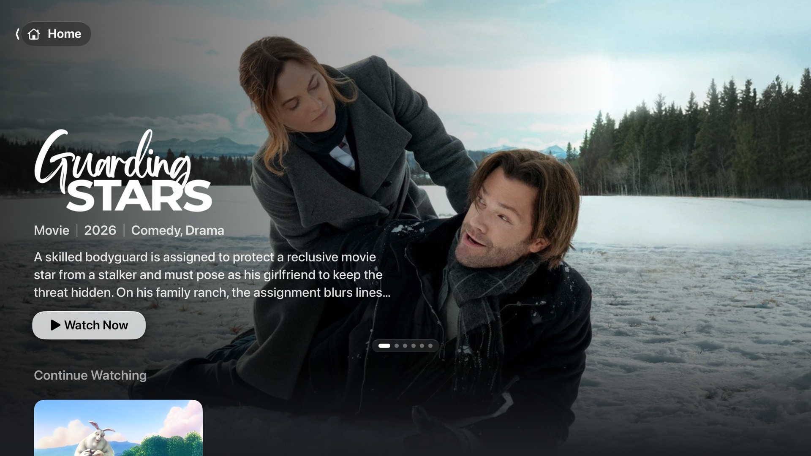
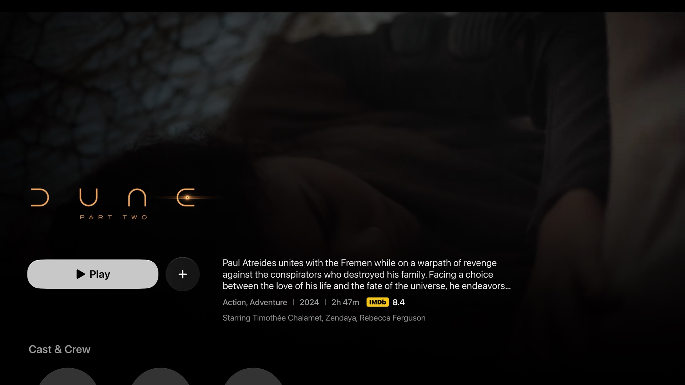
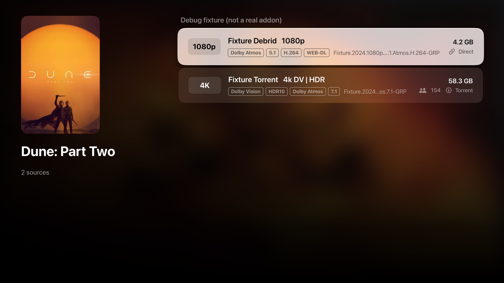
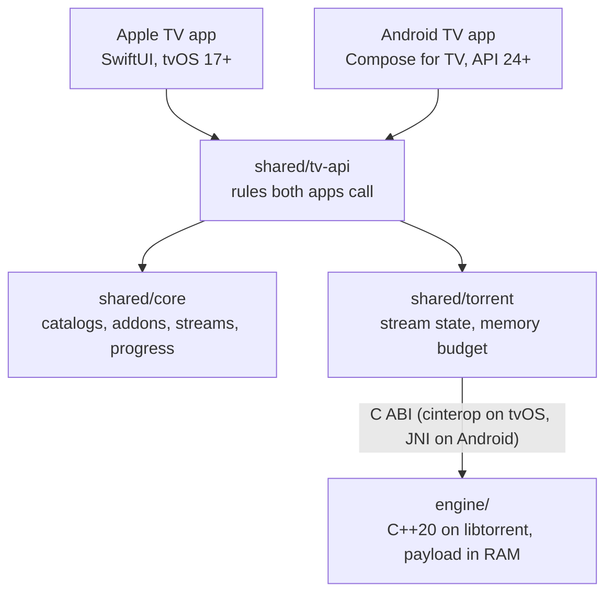

# Movies

One streaming app for the living room, built natively twice: **Apple TV** (SwiftUI) and
**Android TV** (Compose for TV). One Kotlin core runs both. One torrent engine, written here in
C++, streams straight from RAM.

<p align="center">
  
</p>

| | |
|---|---|
|  |  |
|  |  |

## Highlights

- **Looks like the Apple TV app.** Full bleed Spotlight with title logos and a text crossfade,
  Continue Watching cards with logo, progress and "S1, E1 · 17m", trailers in the hero.
- **Press Continue, it plays.** The card resumes from the link the title last played from, at
  the saved position. A dead link falls back to the source list with a notice.
- **Every source, ranked.** All addons in one list, with 4K, HDR, Dolby Vision, Atmos, codec
  and size read from the release name. Direct links and torrents side by side.
- **Subtitles in your language.** Picked from the file, or from online subtitles when the file
  has none.
- **Torrents from RAM.** Magnet in, video out over a loopback HTTP gateway. A 90 GB remux plays
  inside a fixed cap (512 MiB on Apple TV, 192 MiB on a 1.9 GB box), nothing written to flash.
- **Native players.** AVPlayer and mpv on Apple TV, ExoPlayer on Android TV.

## How it is built



- **Logic once, UI twice.** Subtitle choice, last link, ranking, progress: Kotlin in `shared/`,
  tested once, run by both apps. Each app draws with its own system components.
- **Apple TV is the spec.** Sizes and motion measured on Apple's TV app, ported at `dp = pt / 2`.
- **Built for a cheap box.** 32-bit, 1.9 GB RAM, fill rate bound GPU: gradients are baked into
  bitmaps, fades skip offscreen layers, every cut measured with perfetto first.

## Measured

Release `box` builds, `box/perf/measure.sh`. Before: the previous Android TV app (Spotlight: the
build before its crossfade).

| | Before | Now |
|---|---|---|
| Cold start, Mi Box | 1,038 to 1,270 ms | **395 to 409 ms** |
| Memory (PSS), Mi Box | 328 to 355 MB | **96 to 103 MB** |
| Details jank, Mi Box | 7.7 to 8.3% | **3.4 to 4.0%** |
| Spotlight step, median frame, TCL | 25 ms | **9 ms** |
| Torrent start, 4K film (Mac, real swarm) | 45 to 90+ s | **8 to 30 s** |

## Status

| | Apple TV | Android TV |
|---|---|---|
| Home, Details, Streams, Player, Search, Addons, Settings | Done | Done |
| Continue Watching card, last link, subtitle language | Done | Done |
| Torrents on our engine | Done, Apple TV 4K | Runs; box numbers not verified yet |
| Library, mark as watched | Done | Next |
| Trailers in the hero | Done | Off on the box (GPU budget) |

Plans and acceptance criteria: `docs/android-tv-rebuild.md`, `docs/engine-rebuild.md`.

## Build

```bash
make apple-tv-sim       # Apple TV app for the simulator
make android-tv         # Android TV box APK (R8, armeabi-v7a)
make check              # shared, engine and Android TV tests, lint
make help               # every other target
```

macOS, JDK 17. Gradle 9.4.1, AGP 9.2, Kotlin 2.4.10, NDK 29. The first engine build fetches
Boost 1.86 and libtorrent 2.0.12, pinned by SHA-256.

## License

GPL v3, see `LICENSE`. `shared/core` and the first Apple TV sources started as a fork of
[NuvioMedia/NuvioMobile](https://github.com/NuvioMedia/NuvioMobile); its history is kept here.
