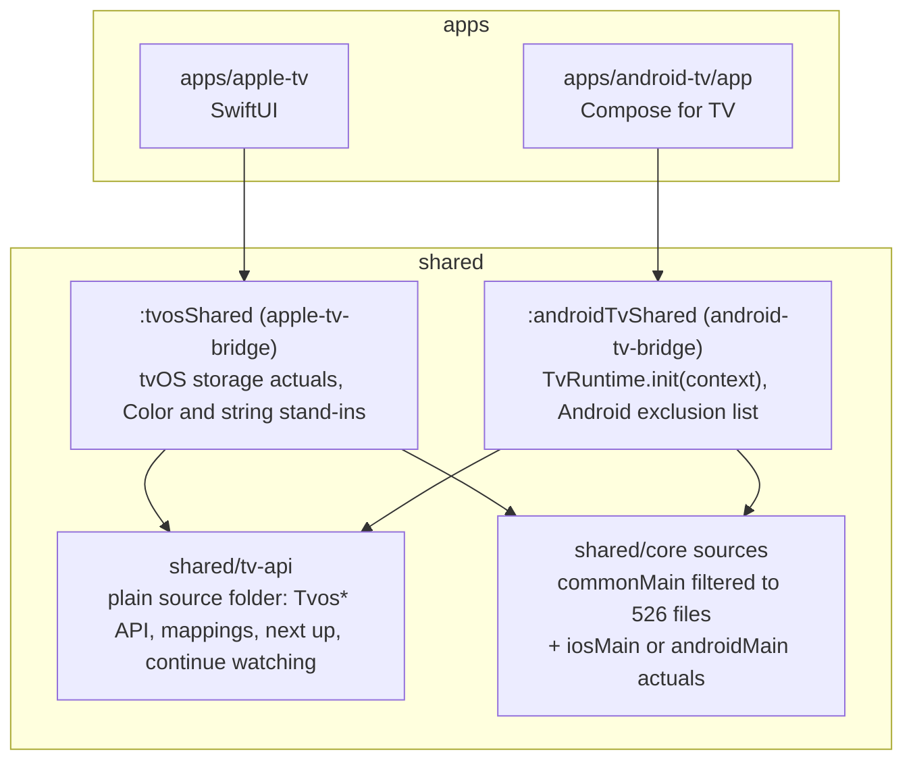

# Android TV rebuild: guideline and slices

Status: plan, nothing built yet. Written 2026-11-23.

The old `apps/android-tv` (about 1,650 Kotlin files, 400k lines, its own copy of the logic) is
thrown away. The new Android TV app is a small Compose for TV app that mirrors `apps/apple-tv`
file by file (68 Swift files, 6.3k lines in `Sources`) and uses the same Kotlin logic through
`shared/`.

Each slice below is one pull request that leaves `main` working. Start a slice by reading this
file, then the Swift files the slice names.

## 1. Decisions

Decisions 1 to 4 were taken on 2026-11-23 when the build started: decision 1 as asked by the user,
2 to 4 as the defaults below. Decision 5 was taken by the user the same day, decision 6 on 2026-11-24. Change one only by editing this table in a PR.

| # | Decision | Taken | Why | Alternative not taken |
|---|---|---|---|---|
| 1 | When to delete the old app | First (slice A0), behind a git tag | You asked for it gone; the box keeps the installed APK either way | Delete at cutover (A14) and build in a second folder until then |
| 2 | Root navigation | Sidebar (`ModalNavigationDrawer` from tv-material) | It is what the tvOS app shows on tvOS 18+, and it is a system component. Checked on tvOS 27 hardware on 2026-11-23: `.sidebarAdaptable` draws the same collapsed pill and floating panel as Apple's TV app (the 27.2 simulator shows a top tab bar instead) | The floating top tab bar of the old box build (commit `d005eae298`): hand built, about a dozen focus rules |
| 3 | Import old data on the box | No importer | The box install dates from 2026-11-22, so it holds one day of addons and progress | A one time importer of `addon_preferences` and the three `watch_progress_*` DataStores; needs the same applicationId, the same signing key and versionCode above 1080 |
| 4 | Package id while building | `com.kien.movies.next`, next to the old app | The old app stays usable every evening until cutover | Use `com.kien.movies` from day one and uninstall the old app now |
| 5 | What happens to Nuvio after cutover | We own `shared/core`: slice A15 deletes the UI files both bridges exclude and Nuvio's mobile app parts, keeps the logic, and drops the exclusion lists | Both TV apps run Nuvio's logic (about 257k lines: catalog, addons, streams, progress, Trakt); only the UI was rebuilt, so the logic stays, the dead UI goes | Keep tracking upstream NuvioMobile; or rewrite the logic from scratch (weeks, no smoothness gain); a package rename away from `com.nuvio.*` was not asked for |
| 6 | Order of tvOS and Android work | tvOS first: the tvOS features in section 7 (F1 to F8) are built and merged before Android ports them, and Android ports a screen only from `main`, never from an open tvOS pull request | Android was chasing a tvOS spec that was still changing in open pull requests (A12c to A12g sat on unmerged tvOS branches). The logic of F1 to F8 already exists in `shared/core`, so tvOS builds the `shared/tv-api` facades once and Android only ports the UI. Android work that does not depend on the tvOS look (engine E5 and E6, box performance) goes on in parallel | Build each feature on both platforms at once; or port the tvOS app only when it is complete |

## 2. Target

- Platform: Android TV, Google TV, TV boxes. Kotlin, Jetpack Compose, `androidx.tv:tv-material`.
- Minimum OS: API 24 (the `shared/` minSdk). Test box: Mi Box MiTV-AFKR0, Android 14 (API 34),
  armeabi-v7a only, 1.9 GB RAM, 4K panel driven at 1920x1080, density 320, so 960x540 dp.
- Input: D-pad remote (arrows, select, Back, media keys). No touch surface, so nothing that
  depends on a swipe.
- Viewing distance: about 3 m.
- Safe region: content stays 48 dp from the sides and 27 dp from top and bottom. Backgrounds,
  hero art and rows run to the screen edge.
- Size range: one bucket, 960x540 dp, landscape only.

Library versions on Google Maven on 2026-11-23: tv-material 1.1.0, tv-foundation 1.0.0, Compose
BOM 2026.11.01, media3 1.11.1 stable. Check the docs of the pinned version when a slice starts;
do not write these APIs from memory.

## 3. Architecture



### How the logic is shared

- The tvOS bridge does not depend on `:composeApp`. It compiles `shared/core` sources into its
  own module and drops 299 of the 825 `commonMain` files (UI, and what fails to compile without
  it) through `excluded-by-rule.txt` and `excluded-by-compiler.txt`. The Android bridge is built the same way, so both TV apps run the
  same 526 logic files and can call `internal` core helpers.
- The API Swift calls (`TvosHome`, `TvosDetails`, `TvosStreams`, `TvosSearch`, `TvosAddons`,
  `TvosPlayback`, `TvosSubtitles`, `TvosTorrent`, `TvosDebugAddon`, 2,085 lines) is plain Kotlin
  apart from `PayloadFileStore.kt`. It moves to `shared/tv-api/` and both bridges add it with
  `kotlin.srcDir`. Names stay `Tvos*` for now; a rename is a later mechanical slice, not a blocker.
- Two single target modules, not one module with two targets: the tvOS side needs a home made
  `androidx.compose.ui.graphics.Color` (`TvosColor.kt`) that would clash with the real class on
  Android. On Android the bridge depends on the real `ui-graphics` and keeps the English string
  stand-in.
- Android actuals come from `shared/core/src/androidMain` (plus `androidPlaystore` stubs). Start
  from the actuals that the 526 included common files need, then close the compiler errors.
  Write the result to `shared/android-tv-bridge/excluded-android.txt`, one path and one reason
  per line, like the tvOS lists. Always excluded: `MainActivity`, `LinkActivity`, the player
  composables, orientation lock, picture in picture, haptics, notification permission, downloads.
- `TvRuntime.init(context)` in the Android bridge repeats the storage and engine `initialize`
  calls of `shared/core/src/androidMain/kotlin/com/nuvio/app/MainActivity.kt:86-149`, without UI.
  The storages read `preferences?.` and return null when not initialised: nothing crashes, data
  is silently lost. Two guards: a script in `make check` that fails when an included object with
  `fun initialize(` is missing from `TvRuntime.init`, and a persistence round trip test.
- Do not edit `shared/core` for the TV apps. It is upstream code. Put TV logic in `shared/tv-api`
  or, when a UI file must be split, add a patch in the style of `apple-tv-bridge/upstream-prs/`.

### Gradle

- The new app joins the `shared/` Gradle build as a project, so there is one toolchain and
  `scripts/toolchain-check` can go:

  ```kotlin
  // shared/settings.gradle.kts
  include(":androidTvShared")
  project(":androidTvShared").projectDir = file("android-tv-bridge")
  include(":androidTvApp")
  project(":androidTvApp").projectDir = file("../apps/android-tv/app")
  ```

- `shared/core/build.gradle.kts:264-294` demands a distribution for assemble tasks. Pass
  `-Pnuvio.android.distribution=full` from the Makefile, or set `NUVIO_ANDROID_DISTRIBUTION` in
  `shared/local.properties`.
- Build types: `debug` (instrumented tests only) and `box` (R8, resource shrinking, not
  debuggable, armeabi-v7a, baseline profile). Jank numbers come only from `box` installed with
  `box/install.sh`.
- No Hilt, no KSP, no Retrofit, no DataStore in the app: the bridge objects are singletons and
  own all storage and networking.
- Signing values come from `shared/local.properties` only. The old `app/build.gradle.kts:187,189`
  has hard coded password fallbacks: do not copy them.

### Folder structure

What the repo looks like once A0 to A3 have landed. `(new)` is created by this rebuild, `(moved)`
comes from the old app or the tvOS bridge, everything else exists today and stays.

```
the-firm/
  CLAUDE.md
  Makefile                      android-tv targets call the shared/ Gradle build
  .editorconfig        (moved)  ktlint rules, scoped to *.kt and *.kts
  docs/
    android-tv-rebuild.md
  scripts/
    ktlint
    check-tv-runtime-init (new) fails when an initialize() object is missing from TvRuntime.init
                                (check-layering and toolchain-check are deleted in A0)
  engine/                       the torrent engine of both apps (docs/engine-rebuild.md)

  shared/                       the one Gradle build for everything Kotlin
    settings.gradle.kts         + :androidTvShared, :androidTvApp, :androidTvBaselineProfile
    gradle/libs.versions.toml   + tv-material, Compose BOM, nanohttpd, zxing
    local.properties            signing values and ABIS (moved from apps/android-tv, not in git)
    core/                       upstream logic, never edited for a TV feature
    tv-api/            (new)    plain source folder, both bridges add it with kotlin.srcDir
      src/commonMain/kotlin/com/nuvio/tvos/
        Tvos*.kt       (moved)  the API Swift and Android call, from apple-tv-bridge/tvosMain
        rules/         (new)    pure rules both apps need:
          StreamFeatures.kt        resolution, HDR, audio, size, seeders from addon text
          PlaybackAdvisory.kt      rating and up to 3 genres
          OnlineSubtitleChoice.kt  source order, 4 per language, labels
          ProgressSavePolicy.kt    10 s and 1,000 ms rule, when to sync remote
        phone/         (new)    AddonPairingSession.kt, AddonPairingRequest.kt (section 5b)
      src/commonTest/kotlin/com/nuvio/tvos/
        mapping tests  (moved)  from apple-tv-bridge/src/tvosTest (all but PayloadFileStore)
        rules/, phone/ (new)    ported from apps/apple-tv/Tests, plus pairing tests
    apple-tv-bridge/            :tvosShared, keeps only what is Apple specific:
      src/commonMain/           Color and string stand-ins
      src/tvosMain/             PayloadFileStore and the three storage actuals
      src/tvosTest/             PayloadFileStore and payload size tests
    android-tv-bridge/ (new)    :androidTvShared, KMP with one Android library target
      build.gradle.kts          core commonMain and androidMain minus the exclusions, + tv-api
      excluded-android.txt      one path and one reason per line
      src/androidMain/kotlin/com/nuvio/tvos/android/
        TvRuntime.kt            init(context): the storage and engine initialize calls, no UI
      src/androidDeviceTest/kotlin/com/nuvio/tvos/android/
        PersistenceRoundTripTest.kt  two runs with am force-stop between them

  apps/
    apple-tv/                   unchanged, except that it reads rules from tv-api once a slice
                                switches it (its Swift copies stay until then)
      TestAddon/                test addon server used by both apps' UI tests
    android-tv/        (new)    rebuilt from scratch
      README.md                 how to build, install on the box and measure
      app/                      :androidTvApp
        build.gradle.kts        debug and box build types, armeabi-v7a, applicationId
                                com.kien.movies.next until A14
        proguard-rules.pro (moved)  keeps for the media3 fork and JNI (the torrent engine's come
                                from shared/torrent since E7)
        libs/          (moved)  only AARs the bridge does not already link:
                                lib-decoder-ffmpeg-release.aar (downmix build)
        src/main/
          AndroidManifest.xml   leanback launcher, banner, INTERNET, cleartext config
          res/
            mipmap-*/ic_launcher.png, mipmap-xhdpi/banner.png  (moved, default colour only)
            xml/network_security_config.xml  (moved)
            values/themes.xml   flat window background, no splash
            values/strings.xml  app name
          kotlin/com/kien/movies/
            MoviesApp.kt        Application: TvRuntime.init off the main thread, TvosHome.start
            MainActivity.kt     waits on runtimeState, then setContent { RootScreen() }
            DependencySmoke.kt  compile only references to every library the slices need (A3)
            shell/              RootScreen, RootTabs (sidebar), Router, AppRoute (with RootTab),
                                RouteViewModelStores, ShellViewModel, WindowBackground,
                                PlaceholderScreen (A3; no RouteLink: screens call router.open)
            design/             Tokens, Theme, CardShape, CardFocus, GlassStyle (flat fills),
                                Backdrop, ArtworkImage, MetadataLine (A3); DpadThrottle,
                                SemanticsPruning (added by A4, the Home slice)
            bridge/             BridgeFlows (observe callbacks as Flow, one shots as suspend)
            home/               HomeScreen, HomeViewModel, HomeHero, HomeStatus, CatalogRow,
                                ContinueWatchingRow, PosterCard, RowNeighbor
            details/            DetailsScreen, DetailsViewModel, DetailsHero, DetailsInfoSection,
                                EpisodesSection, CastSection
            streams/            StreamsScreen, StreamsViewModel, StreamsHeader, StreamGroupList,
                                StreamsRow, StreamDetailSheet, StreamsEmpty, StreamRowState
            search/             SearchScreen, SearchViewModel
            addons/             AddonsScreen, AddonsViewModel, AddonRow, AddonInstallPanel,
                                AddonPreview, AddonDetailScreen
              phone/            PhoneAddonPanel, PhoneAddonDialog, PhoneAddonServer,
                                PhoneAddonPage (HTML), LanAddress, QrCode
            player/             PlaybackScreen, PlaybackRequest, PlaybackMetadata, PlayerFactory,
                                PlayerController, PlayerState, PlayerScreen, PlayerSurface,
                                TransportBar, HoldScrub, PlayerPanels, PlayerTracks,
                                PlayerMediaInfo, PlaybackAdvisoryBanner, StartupDeadline,
                                StallWatchdog
            torrent/            TorrentSession, TorrentCacheBudget
            debug/              DebugLaunch: src/debug reads the intent extras, src/box is a twin
                                with every option off (A3). StreamsDebugFixture lives in
                                streams/, used only when DebugLaunch.usesStreamFixture
        src/test/kotlin/com/kien/movies/
                                RowNeighborTest, PlayerStateTest, HoldScrubTest,
                                StartupDeadlineTest, StallWatchdogTest, TorrentCacheBudgetTest,
                                PhoneAddonServerTest
        src/androidTest/kotlin/com/kien/movies/
          support/TvRobot.kt    launch extras, D-pad and wait helpers (like UITests/Support)
          NavigationTest, HomeTest, ContinueWatchingTest, DetailsTest, StreamsTest,
          PlayerTest, PlaybackFailureTest, SearchTest, AddonsTest, PhoneAddonTest
                                one test per AC, the AC id first in the name:
                                fun h5_removedCardStaysGoneAfterRelaunch()
      baselineprofile/ (new)    :androidTvBaselineProfile
        src/main/kotlin/com/kien/movies/baselineprofile/
          BaselineProfileGenerator, Journeys, StartupBenchmark, ScrollBenchmark
      box/             (moved)  same paths as today
        install.sh
        perf/measure.sh         package and key scenario rewritten in A2 and A4
        perf/results/           not in git; old runs kept as legacy-agp8-movies-1625/
        legal-test-addon/
        brand/
      third_party/
        ffmpeg-decoder-downmix/ (moved)  GPL source and NOTICE of the decoder AAR, not a Gradle
                                module; README says how to rebuild the AAR
```

Package rule: Android code is grouped by feature, tvOS keeps its flat `Sources/`. Names map
one to one so a feature is found on both sides:

| tvOS | Android | Example |
|---|---|---|
| `XxxView.swift` that is a screen | `XxxScreen.kt` | `HomeView` to `HomeScreen` |
| `XxxView.swift` that is a part | `Xxx.kt` | `CatalogRowView` to `CatalogRow`, `BackdropView` to `Backdrop` |
| `XxxModel.swift` | `XxxViewModel.kt` | `StreamsModel` to `StreamsViewModel` |
| `MpvXxx.swift` (mpv engine) | `PlayerXxx.kt` or the plain name (ExoPlayer engine) | `MpvTransportBar` to `TransportBar`, `MpvPlaybackController` to `PlayerController` |
| Pure rule (`StreamFeatures`, `PlaybackAdvisory`, `MpvSubtitleDownload`) | `shared/tv-api/.../rules/` | Android uses the Kotlin copy from day one; tvOS switches in a later slice |
| Any other file | same name, `.kt` | `HomeHero`, `PosterCard`, `EpisodesSection` |

tvOS files with no Android counterpart in v1: `PlaybackPreflight`, `PlayerView`,
`PlaybackController`, `PlayerItemBuffer` (AVPlayer only), `MpvHandle`, `MpvVideoView`,
`MpvOptions`, `MpvPlaybackClock`, `MpvTouchpad`, `MpvTouchScrubber`, `MpvSwipeScrub` (replaced
by `HoldScrub`), `MpvDisplayMatch` (later: frame rate match).

AAR rule: exactly one copy of each AAR on the app's classpath. The bridge links what core's
Android actuals need from `shared/core/libs` (engine and media3 fork); its media3 AARs are `api`
so the app's player compiles against the same copy (A3). The app links `lib-ui-release.aar`
from `shared/core/libs` once, for `SubtitleView` (A3), plus `recyclerview` that the AAR needs at
run time; `app/libs` holds only the downmix FFmpeg decoder. The fork calls three stock 1.8.0
modules it does not ship, linked by the bridge: `media3-container` (`api`; NalUnitUtil and
ObuParser for the extractor and ExoPlayer), `media3-effect` (GlEffect for libass) and
`media3-decoder`; stock `media3-common` and the other forked modules stay excluded. A2 decides which
`lib-datasource-release.aar` copy wins.

### Data and state

- The bridge owns the data. Screens read these and nothing else: `TvosHomeState`,
  `TvosDetailsState`, `TvosStreamsState`, `TvosSearchState`, `List<TvosAddon>`,
  `TvosTorrentStatus`, `TvosResumePoint`, `TvosStreamTarget`. All user facing labels (play
  button, resume, continue watching subtitles, empty states) already come from Kotlin.
- `bridge/BridgeFlows.kt` turns `observeX(cb): TvosCancellable` into a `callbackFlow` whose
  `awaitClose` calls `cancel()`. A ViewModel exposes one `StateFlow<UiState>` with
  `stateIn(viewModelScope, WhileSubscribed(5_000), initial)`. Screens use
  `collectAsStateWithLifecycle`.
- App owned state:
  - `AppRoute`: `Tab(RootTab)`, `Details(type, id)`, `Streams(target, resumesDirectly)`.
    `Router` is a list back stack with `open(route)`, as in `Router.swift`; the bottom entry is
    always a tab root and `selectTab` replaces the stack. Each entry has an id, its own saved
    state slot and its own ViewModel store (cleared on pop; tab roots keep theirs). The router
    lives in an Activity ViewModel, so it survives a configuration change; a process restart
    starts at Home. The player is a full screen cover over Streams, not a route: the seam is
    `player/PlaybackRequest.kt` (`PlaybackRequest`, `StreamNotice`) and
    `PlaybackScreen(request, onFailure, onExit)`.
  - Stream row: `Idle -> Checking -> Playing -> Idle`, `Idle -> TorrentStarting(step, peers,
    buffer) -> Playing`, any state `-> Notice(title, message)`. A press is ignored while another
    row is not `Idle`.
  - Player: `Loading -> Playing <-> Paused`, `Playing <-> Buffering`, `-> Ended`, `-> Failed`.
    Scrub: `None -> Pending(previewMs) -> None` by commit or cancel.
    `Loading` fails after 20 s without data (`StartupDeadline`), `Buffering` after 20 s without
    buffer growth (`StallWatchdog`).
  - Progress: save through `TvosPlaybackSession.save` every 10 s when the position moved at
    least 1,000 ms (local only); on pause, end, exit and `onStop` with `syncRemote`. Never
    before playback has started.

## 4. Mirroring the tvOS design

### Units and tokens

Sizes, colours, type and motion come from `docs/tv-look-spec.md`, measured on Apple's TV app on a
tvOS 27 Apple TV (2026-11-23). It is the single source for both apps; this section keeps only the
rules it does not cover. Rule: `dp = pt / 2`, `sp = pt / 2`, then round. All values live in
`design/Tokens.kt` (Android) and one tokens file on tvOS; no literal sizes in screens.

Screens the TV app does not have (Streams, our player chrome, Addons, Settings) keep the tvOS app's
own values:

| Token | tvOS | Android TV |
|---|---|---|
| Stream row, resolution badge | 104, 124x64 pt (134 pt with the bordered button's padding) | 52, 62x32 dp (67 dp with the button's padding) |
| Streams title column | 560 pt, 40 pt from the list | 280 dp, 20 dp from the list |
| Titles (player, streams) | 54, 52 pt | 27, 26 sp |
| Small text floor | 19 pt | 12 sp; 11 sp only inside badges |

### Not ported literally

| tvOS | Android TV | Reason |
|---|---|---|
| Full screen gradient backgrounds (Home, Details) | One flat colour set as the window background: Home `#24282E`, Details `#1B1D22` (gradient midpoints, tune on the panel) | Measured on the box: a full screen gradient costs about 6.5 ms of a 16.7 ms frame |
| Backdrop blur 40 plus 45% black when receded | A second, tiny decode of the same image (about 96 px wide) scaled up, darkened with a colour filter on the image | Runtime blur and extra translucent layers are fill passes on a fill rate bound GPU |
| Glass buttons and panels (tvOS 26) | Flat frosted fills: white 14%, 22%, 30%, with a 1 dp white 16% edge (the glass edge in `tv-look-spec.md`, like the YouTube TV app); focused control is solid white with black content and no edge | The look does not exist in the Android toolkit; a 1 dp stroke costs almost nothing on the box, a blur does not |
| System focus lift and specular highlight | Scale in `graphicsLayer`, read in the draw phase; the card never changes layout size | A size change on focus re-measures the row every frame |
| Poster genre shade, hero shades | Keep, but one gradient per card, drawn only over the text band; one hero scrim instead of two | About 14 small scrims cost 1.5 ms: budgeted, not free |
| Swipe scrubbing (`MpvSwipeScrub`, `MpvTouchpad`) | Hold left or right: key repeat grows the step, preview on the bar, seek 900 ms after the last key | No touch surface on the remote |
| AVPlayer or mpv chosen by file extension (`PlaybackPreflight`) | ExoPlayer for everything in v1 | ExoPlayer plays MKV, TS, HLS and DASH itself; mpv is a later fallback |
| Context menu (long press) on a card | Long press select opens a small dialog | Check tv-material for a menu component first; a dialog is the fallback |
| `.searchable`, inline one row keyboard | One row keyboard built in Compose, system IME for "123" | Android has no inline keyboard; the IME covers the results the TV app keeps visible |
| Floating glass sidebar panel and collapsed "‹ Home" pill | `ModalNavigationDrawer` content drawn as the pill when closed and an opaque panel when open | No blur on the box; the drawer stays the system component |
| `sidebarAdaptable` tab view | `ModalNavigationDrawer`, flat scrim, no blur | Platform component, see decision 2 |

### Focus rules

- Exactly one focused element in every state, including loading, empty and error.
- Home is a `LazyColumn` of `LazyRow`s. Each row remembers its last focused card
  (`focusRestorer`), each lazy list has stable `key` and `contentType`.
- Back returns to the same card on every level (Streams, Details, Home), then opens the sidebar,
  then leaves to the launcher. No exit dialog. The shell's order (A3): a screen's own Back
  handler first (player, dialog); pop while deeper than a tab root; at a tab root with focus in
  the content, focus the sidebar on the selected tab; sidebar focused on another tab, select
  Home; sidebar focused on Home, leave. That is one press more than tvOS from a tab other than
  Home (tvOS leaves from any tab's sidebar), as Android's TV navigation guide asks; tvOS keeps
  its behaviour.
- The shell saves which element had focus before every stack change and gives it back when the
  entry returns, through the entry's saved state. A screen only adds `focusRestorer` inside its
  own rows.
- Up and down move between rows, left and right inside a row. Fix a missing straight path by
  moving the control, not with a custom focus jump.
- Import check on every screen: `androidx.tv.material3.*`, never `androidx.compose.material3.*`
  for controls.

### Box performance rules

- No full screen gradient, no stacked translucent layers, no runtime blur. Check with
  `adb shell setprop debug.hwui.overdraw show` and a perfetto trace before naming a cause.
- Port from the old app (read it from the `android-tv-legacy` tag): the semantics pruning
  (`ui/util/SemanticsForScreenReaders.kt`, `AccessibilitySemanticsDemand.kt`; it took Home jank
  from 8.0% to about 4%) and `ui/util/DpadThrottleModifier.kt`.
- Images: ask Coil for the exact card size in pixels; never decode a poster at full size.
- Where the shared core can cost frames, and the fix in the app layer, not in core:
  `TvRuntime.init` runs about 60 SharedPreferences initialisations, so keep it off the main
  thread and measure `TotalTime` (old app: 1,038 ms); a bridge state such as `TvosHomeState`
  arrives as one object, so map it to one immutable state per row with stable keys so a change
  in one row does not recompose the others.
- Gate, measured with `box/perf/measure.sh` on the `box` build installed by `box/install.sh`.
  Reference, old app, two runs (files dated 2026-11-23): Home jank 3.56% and 3.73%, p90 30 to
  32 ms; Details jank 7.69% and 8.33%; PSS 328 to 355 MB. The new scenario keeps the same shape
  (scroll Home, open Details, Back) so the numbers stay comparable; the old numbers are a
  reference, not an identical test. The new app must not be worse on any of the three.
- What smooth means here: the box panel runs at 59.94 Hz, a 16.7 ms frame budget. The old Home
  had a median frame of 21 ms (p50) while scrolling, so most frames missed 60 fps even though
  the jank counter read 3.6%. Target for the new Home and Details scroll (a target, change it if
  it proves wrong): p50 at or under 16 ms, p90 at or under 25 ms, jank under 3%.
- Reference app on the same box: Apple TV 17.0.4 (`com.apple.atve.androidtv.appletv`). Its APK
  has almost no Java code; the UI is Apple's own engine (`libluna.so`, 19 MB, embeds V8, draws
  with OpenGL ES 2 on a native window, decodes with NDK MediaCodec) running JavaScript from
  `assets/app.zip`. It ships a baseline profile too. `gfxinfo` does not see it (no HWUI frames):
  compare it with `dumpsys SurfaceFlinger --latency` on its layer, during the same scroll.

## 5. Player on Android

- Engine: Media3 ExoPlayer from the forked 1.8.0 AARs (no source in the repo, known good on the
  box) plus the FFmpeg audio decoder with the downmix. Stock media3 1.11 is a later slice that
  needs the decoder rebuilt from `ffmpeg-decoder-downmix/`.
- AAR copies differ between the two folders. Same hash in both: common, datasource-okhttp,
  decoder-av1, decoder-mpegh, exoplayer, exoplayer-hls, extractor, nuvio-engine 0.1.6, libass,
  quickjs, ui. Different: `lib-decoder-ffmpeg-release.aar` (app copy 3.8 MB is the downmix
  build, core copy 9.2 MB) and `lib-datasource-release.aar` (177,533 against 177,480 bytes).
  Only in the old app: `lib-decoder-iamf`, `nextlib-mediainfo-local`. The new app links the old
  app's downmix FFmpeg decoder and core's `lib-datasource-release.aar` (A2: the old app's copy
  was not kept), and drops iamf, mediainfo and quickjs. `lib-ui` was dropped in A2 and linked
  again in A3, for `SubtitleView` and `AspectRatioFrameLayout`, not for `PlayerView`.
- UI: one custom Compose player that copies `MpvPlayerScreen.swift`, `MpvTransportBar.swift` and
  `MpvPanels.swift`: title block, three round buttons (Subtitles, Audio, Info), transport bar,
  panels. Not the media3 `PlayerView` controls.
- Remote: select toggles pause; left and right skip 10 s and add up; holding scrubs; down
  enters the scrub view, up goes to the buttons; play/pause key toggles and commits a pending
  scrub. Controls hide after 5 s unless paused, a panel is open or a scrub is pending.
- Back order, as on tvOS: close panel, cancel pending scrub, leave scrubbing, focus the video
  surface, hide controls, exit.
- Leaving the app pauses and saves. Bars around the video are black.
- Torrents: `TvosTorrent` on the new engine in `engine/`, through `shared/torrent` and JNI
  (`docs/engine-rebuild.md`, E6 and E7), payload in RAM only. Its memory budget comes from
  `budgetFor` with the memory free when the engine opens. The `P2pStreamingEngine` Android actual
  and `lib-nuvio-engine-android-0.1.6.aar` are no longer linked (E7).

## 5b. Add addons from a phone (QR)

Not in the tvOS app: an Android TV addition, asked for on 2026-11-23. Typing a manifest URL with
a remote is slow, so the TV shows a QR code, the phone opens a small page from it and sends the
URL to the TV.

How it works:

1. On Addons, the install panel has "Add from phone". Selecting it starts a local HTTP server on
   the first free port from 8080 to 8089 and shows a QR code for
   `http://<tv-lan-ip>:<port>/?t=<token>`, the same address as text, and "Waiting for your phone".
2. The phone opens the page: one field (several URLs allowed, one per line, at most 10) and a
   Send button. `stremio://` links are fine: `normalizeManifestUrl` in core turns them into
   `https://`.
3. The page sends `POST /api/addons` with the token and the URLs. The TV shows a dialog with
   each URL and Install or Cancel, focus on Install.
4. Install runs each URL through `TvosAddons.install`, the same path as typing it. The page polls
   `GET /api/status/<id>?t=<token>` and shows the result per URL (installed with its name, or the
   error from Kotlin).
5. The server stops when the panel closes, when the app goes to the background, or after
   10 minutes without a request.

Session state: `Off -> Waiting -> Proposed(urls) -> Installing -> Done(results) -> Waiting`, any
state `-> Off`. A new proposal while one is `Proposed` or `Installing` gets HTTP 409.

Access model:

- Whoever can read the TV screen can add addons: the token in the QR is 128 random bits from
  `SecureRandom`, new for each session, checked on every request with a constant time compare.
  A request without it gets 403 and changes nothing.
- Every change is confirmed on the TV with the remote. The phone only proposes.
- The page only adds. Removing, turning off and ordering stay on the TV (the old app's page also
  edited catalogs and collections; that is not ported).
- Input checks before anything reaches the dialog: body at most 16 KB, at most 10 URLs, each at
  most 2,048 characters, scheme `https`, `http` or `stremio`. The manifest itself is checked by
  core when it installs.
- Plain HTTP on the home network: someone sniffing the LAN during the session could read the
  token. Accepted for a home box, and the TV confirmation still stands in the way.

Placement:

- `shared/tv-api`: the session state machine, token check, request parsing and URL limits, as
  plain Kotlin with unit tests, so tvOS can add the same feature later with its own listener
  (Network.framework).
- Android app (`addons/phone/`): the HTTP server (`org.nanohttpd:nanohttpd:2.3.1`, what the old
  app ran on the box), the LAN address from `ConnectivityManager.getLinkProperties` (the old
  `WifiManager.connectionInfo` path is deprecated and misses Ethernet first), the QR from
  `com.google.zxing:core:3.5.3` drawn with a Compose `Canvas` as black squares on white, at
  least 180 dp so a phone reads it across the room, and the page as one small HTML string with
  inline script.
- From the old app (tag `android-tv-legacy`): read `core/server/AddonConfigServer.kt` for the
  propose, confirm and poll flow and `core/qr/QrCodeGenerator.kt` plus its test for the module
  grid. Do not port `AddonWebPage.kt` (3,695 lines).

States to lay out: no network ("Connect the TV to Wi-Fi or Ethernet"), no free port, waiting,
proposal dialog, installing, results. Each holds focus.

## 6. Acceptance criteria (assumed: parity with the tvOS app on the box, plus 5b)

Taken from `apps/apple-tv/UITests`. Each is checked with the D-pad only.

| Id | Criterion |
|---|---|
| N1 | Launch puts focus on the hero button of Home |
| N2 | The sidebar reaches Home, Search, Library, Settings (Addons is a Settings page, ST1); Back on the sidebar of another tab selects Home, Back on the Home sidebar leaves to the launcher (Android; tvOS leaves from any tab, see section 4) |
| N3 | Left from the hero opens the sidebar, down reaches the first row |
| N4 | Poster, then Details, then Streams; Back returns to the same card at each step |
| N5 | The Library tab is reachable and holds focus (LB2 when empty). Android still shows its placeholder until it ports F1 |
| N6 | Push and Back cross fade the two screens in place, as tvOS does (push 300 ms, Back 220 ms); a tab change does not fade; the leaving screen never takes focus, and N4 still holds |
| LB1 | Library lists saved titles as shelves, one per section `LibraryRepository` gives (by type for the local list, by list such as Watchlist when Trakt is the library source); a poster opens Details. tvOS since F1; Android needs the same change |
| LB2 | An empty Library says so and holds focus, so the sidebar closes |
| LB3 | Details shows a round Library button right of Play (plus when not saved, check when saved, labelled "Add to Library" and "In Library"); pressing it saves or removes the title, Library follows at once and after a relaunch. Focus on it keeps the backdrop forward and the trailer playing (D6) |
| LB4 | When Trakt is signed in and is the library source (the upstream default), the button adds to and removes from the Trakt watchlist through `LibraryRepository.toggleSaved`; a removal the tracker asks to confirm shows a confirmation first, and a failure shows an alert |
| H1 | Hero shows up to 6 items of the first row that have a backdrop; arrows change the item; it advances every 8 s only while unfocused |
| H2 | Catalog rows scroll sideways with the next card partly visible |
| H3 | Loading, empty and error states are laid out and focusable. Android: the empty and error status holds an "Open Addons" button so focus has a target; tvOS has no button there and could get the same |
| H4 | A Continue Watching card resumes without asking |
| H5 | Removing a card moves focus to its neighbour and the card stays gone after relaunch |
| H6 | Finishing an episode shows Next Up on Home and on Details |
| H7 | An addon catalog that needs a year as its genre (Cinemeta "New") shows as a row for its newest year, right after the first row of the same addon and type (Popular Movies, New Movies, Popular Series, New Series). The selection and placement live in Kotlin, so Android gets it from the shared API |
| H8 | The hero artwork fills the screen, behind the peek of the first shelf, and leaves only as Home scrolls down. After 1 s of focus on a hero item, its backdrop fades into the item's YouTube trailer with sound, its volume fading in with the picture; the facts and overview stay as they are. The link is resolved in Kotlin (`TvosTrailers`) ahead of focus for the page showing and the next one, and the player buffers during the wait. A YouTube HLS trailer plays its master playlist cut down to the sharpest H.264 variants (`sharpestTierPlaylist`), so it starts at 1080p instead of the 240p variant YouTube lists first. The trailer plays hidden for under a second while upstream `LetterboxDetector` measures its black bars on small frames (`TvosLetterbox`), then shows already zoomed past them, so no black bars ever show. Picture and sound fade out when the trailer ends, when focus leaves the hero and when another screen opens. Nothing plays when the item has no trailer or the system turns off video autoplay. A lookup made before the addons are ready is tried again. Android (A16) plays it in an ExoPlayer on a `SurfaceView`, so the display composes the video and the box GPU draws no extra layer; the backdrop image and a shades only scrim bitmap lie over it and fade out; `PixelCopy` from the surface feeds `TvosLetterbox`, and the view is sized past the bars instead of scaled. Box cost still to be measured with `box/perf/measure.sh` |
| H9 | Home scrolls like the tvOS app: the hero art and text move with the rows as one page (no parallax, no clip), the art fades into the Home background under the first row, and a focused card comes into view only as far as needed, 90 dp from the top or bottom edge |
| D1 | Details shows logo or title, then Play with the summary beside it (overview, facts, Starring) laid out as the tvOS app does, and the play label that Kotlin gives; there is no info button |
| D2 | A part watched title shows Resume with its bar; the episode shows its percentage |
| D3 | The season picker focuses the selected season on entry; Back from Streams restores episode and season |
| D4 | Cast and Information are reachable by scrolling with the D-pad; there is no About section on either platform (tvOS has none, the overview sits in the top) |
| D5 | Loading and error states |
| D6 | While the Play button has focus, the Details backdrop fades into the title's trailer as on Home (H8: wait, sound fade, letterbox crop, sharpest variants). It fades out when focus moves down to the episodes, cast or information, and when Streams opens; it plays again on return. Android plays it while a hero button has focus, with the H8 player (A16) |
| W1 | A Continue Watching card's context menu (long press Select) offers "Mark as Watched" above Remove, except for a Next Up episode that is not released yet. It marks the episode watched through `WatchingActions.markContinueWatchingWatched`; the card leaves with focus on its neighbour (H5), and a series moves on to its next episode as Next Up. When the card had no neighbour, that Next Up card takes focus if it arrives within 10 s; otherwise (a movie, the last episode, a Next Up that lands in Upcoming, a slow fetch) focus falls back to the hero, as after Remove. tvOS since F2; Android needs the same change |
| W2 | A released episode card's context menu offers "Mark as Watched" or "Mark as Unwatched". The check mark and its "Watched" value change at once and stay after a relaunch; marking clears the episode's progress. tvOS since F2; Android needs the same change |
| W3 | A season tab's context menu offers "Mark Season as Watched" until every released episode of the season is watched, then "Mark Season as Unwatched"; it selects that season and marks or unmarks all its released episodes at once (`WatchingActions.toggleSeasonWatched`), so focus stays on the tab after the menu closes. Cancelling the menu on a season that is not selected moves focus to the selected one (D3). Unreleased episodes and seasons with nothing released have no menu. tvOS since F2; Android needs the same change |
| W4 | When Trakt is signed in, these marks go to Trakt history through `WatchedRepository`, as upstream does. Checked by hand, not by a UI test |
| W5 | A Continue Watching or Upcoming card's context menu (long press Select) starts with "Go to Show" for a series card or "Go to Movie" for a movie card, above "Mark as Watched" and Remove. It opens the Details of the show (not the episode) or the movie, `AppRoute.Details(type, parentMetaId)`, once the menu has closed. The route carries no season: Details opens on the season of its own play action (`seriesPrimaryAction`), which is usually the card's episode but is worked out apart from the card, so an Upcoming card for an unreleased episode can open on another season. The card stays in the row, and Back returns focus to it (N4). tvOS since this change, seen on the simulator; Android seen on the TCL, long press on the real remote opens it (its menu opens beside the card as on tvOS, with Go to and a red Remove and their glyphs, Back closes it; Mark as Watched is still W1's gap) |
| S1 | Stream groups appear per addon as they load; the left column shows the source count and "Searching N more addons" |
| S2 | A row shows resolution, capability badges, size and seeders parsed as on tvOS |
| S3 | Empty state with Try Again and the missing addon hint |
| S4 | A stream that cannot play opens the info sheet |
| S5 | With a resume point, a dialog offers Resume or Start Over |
| S6 | The pressed row shows "Checking stream", the other rows dim |
| P1 | Direct MP4, MKV and HLS streams play |
| P2 | Skip 10 s, presses add up, controls hide after 5 s |
| P3 | Progress is saved and playback resumes after a relaunch |
| P4 | No data for 20 s at start fails and saves nothing; a stall of 20 s mid play fails and keeps progress; both show the notice on Streams |
| P5 | Audio menu reaches every track; subtitle menu has Off, embedded and online tracks (4 per language at most); Info shows the source (stream name, the Streams row's tags such as resolution, HDR and audio, then addon, size and torrent or direct) and the video, audio, audio output (route and player driver), decoder and buffer; no touch diagnostics |
| P6 | The rating and genre advisory shows once for 6 s |
| P7 | Back follows the six step order |
| P8 | Leaving the app pauses and saves |
| P9 | When the buffer runs dry mid play, playback resumes only once 5 s are buffered again, so a source slower than the bitrate stalls in long pauses, not every second. tvOS mpv sets `cache-pause-wait=5`; AVPlayer keeps its own rebuffer logic. ExoPlayer's `bufferForPlaybackAfterRebufferMs` defaults to 5,000 ms, so Android needs no change if it keeps that default |
| P10 | Sound plays to the AirPlay speakers picked on the Apple TV, like the TV app: the audio session uses the long-form audio route sharing policy and the Info.plist sets `AVInitialRouteSharingPolicy`. The picture stays on the TV: AVPlayer (films and trailers) has external playback off, which otherwise sent the video to an AirPlay receiver and left the TV black. Android routes through the system and needs no change |
| P11 | The player's Audio, Subtitles and Info menus keep one left edge: the headers, the plain lines and the text inside the rows start together, and a focused capsule (with its check column) or a tag's outline hangs out past it (tvOS `MpvMenuMetrics.trackLabelLeading`, the Info tags pulled left by their inset). Android draws the menu as one translucent dark layer with the glass rim, so the video shows through as under tvOS glass; no blur. tvOS and Android since this change; the box GPU cost of the translucent menu is not measured yet |
| T1 | A torrent stream starts through the engine, the row shows step, peers and speed (no progress bar), then plays; the engine stops on exit. Until E4 (`docs/engine-rebuild.md`) the engine reports no peers, speed or buffer: Android shows the step only ("Starting torrent", then the engine's "resolving"), with no detail line; tvOS still draws its detail line, with zeros, since E7a |
| T2 | A torrent reads up to 1 GiB ahead of playback (about 90 s of a 4K remux), so a slow patch in the swarm does not stall it. tvOS: since E7a (`docs/engine-rebuild.md`) the new engine reads 256 MiB ahead from RAM, under its 512 MiB cap, until E2 and E3 size the window from memory; the 1 GiB disk readahead went with the old engine. Android (E7) runs the same engine from RAM only, with `budgetFor`: a store cap of a quarter of the memory free when the engine opens, between 64 and 192 MiB, and half of it ahead, so the box reads at most 96 MiB ahead. The disk store (E5) was dropped for the box by the owner |
| Q1 | Typing a title shows result rows |
| Q2 | Opening a result records a recent search; a recent search can be removed |
| Q3 | An empty query shows recent searches and the discover row |
| A1 | Add Addon, focused when the screen opens, takes a manifest URL through the system keyboard; a failure shows why under the QR code |
| A2 | On an addon's page, Enabled turns it off and on in place, and the list row then says Off or On |
| A3 | Move Up and Move Down on an addon's page change its order |
| A4 | Remove Addon on the page asks first, then returns to the list; with no addons only Add Addon is left and the preview says "No addons" |
| A5 | Laid out like the system Settings app, with its sizes measured on an Apple TV: a grouped list 780 pt wide against the right safe edge (Add Addon, then the Installed section), every row on its own platter, and on the left a 540 pt preview of the focused row centred in the space that is left (the addon's logo with up to five lines of summary or its error, or the QR code while Add Addon has focus). The list and its page put the first row and the art at the same height, so nothing moves on the way in. An addon's row shows On, Off or Error and opens the addon's page with the same layout, where the full description sits under About. tvOS uses `List` rows and opens the page through `AppRoute.addon`, because a `NavigationLink` in a `List` inside the sidebar `TabView` does not push. Android builds the same skeleton from Compose for TV list items. Addons is reached from Settings (ST1), not from a tab |
| ST1 | Settings lists Playback, Subtitles, Addons and About in the A5 layout: the list on the right, and on the left the focused page's symbol and what it holds. Playback has first focus. Playback and Subtitles show the chosen language as their value. About shows the name, version, build and licence |
| ST2 | Subtitles lists Off, Automatic (the device language), then every language by name, with a checkmark on the choice; it opens focused on the choice. The choice is saved in core's player settings through `TvosSettings`, so both apps and a relaunch see it. Until a first choice it is Vietnamese, then English, the languages the player picked before Settings existed |
| ST3 | Playback picks the audio language the same way: Automatic or a language |
| ST4 | The player starts with the chosen audio and subtitle language, falling back to the second choice, and with no subtitles when Off is chosen. tvOS mpv gets `alang`, `slang` and `subs-fallback` (or `sid=no`); AVPlayer gets media selection criteria. Android gives ExoPlayer the same through its track selection parameters |
| ST5 | Removed on 2026-11-24: Settings has no Account page on either app, so nothing signs in to Trakt. `TvosTrakt` (the device code flow) stays in `shared/tv-api` with its unit tests, unused by the apps. LB4, W4 and F3 need a sign in and wait until one comes back |
| AQ1 | "Add from phone" shows a QR code and the address as text within 1 s; with no network it says so and keeps focus |
| AQ2 | Scanning the code with a phone on the same network opens the page; sending a manifest URL shows the confirmation dialog on the TV |
| AQ3 | Install adds the addon (it appears in the list and its catalogs on Home); the phone page shows the result per URL; Cancel adds nothing and the page says so |
| AQ4 | A request with a wrong or missing token gets 403 and changes nothing; a second proposal while one is open gets 409 |
| AQ5 | The server stops when the panel closes, when the app goes to the background and after 10 idle minutes: the address no longer answers |
| X1 | `box` build: R8, armeabi-v7a, baseline profile applied (check the compile state of the package) |
| X2 | Jank and PSS are not worse than the old app (numbers in section 4) |
| X3 | No text cut at any edge, every label readable at a quarter size screenshot |

## 7. Slices

| Slice | What it does | ACs | Proof |
|---|---|---|---|
| A0 Rescue and delete | Tag `android-tv-legacy`. Move out what a tag cannot save or the new app needs (list below). Delete the old app, its Makefile targets, `scripts/check-layering` and `scripts/toolchain-check` (it compares two builds, one is gone). `make check` becomes `shared-test` until A2 adds lint and Android tests back. Update README | none | `make check` and `make apple-tv-sim` pass; rescued files exist at their new paths |
| A1 Shared API folder | Move the `Tvos*` API and mappings from `apple-tv-bridge/src/tvosMain` to `shared/tv-api`. No behaviour change | none | `make shared-test` and `make apple-tv-sim` pass, UI tests unchanged |
| A2 Android bridge and bare app | `:androidTvShared` with its exclusion list and `TvRuntime.init`; `:androidTvApp` with a leanback manifest, banner, `box` build type; one Activity that lists Home row titles as text. `make lint`, `make format` and `make android-tv-test` point at the new sources. Timebox it (suggested: two working days); if the exclusion list does not close, take the fallback in section 9 | X1 partly | Round trip in two instrumentation runs with `adb shell am force-stop` between them: run one installs the test addon and saves progress, run two reads both back. `:androidTvApp:dependencies` for the `box` build shows no alpha or beta Compose artifact. `make android-tv`, `make box-install`, row titles visible on the box. Init guard script in `make check` |
| A3 Shell | Tokens, theme, `Router`, `AppRoute`, sidebar with five tabs, placeholders, debug launch extras that mirror `DebugLaunch.swift` | N2, N5 | UI test: every tab reachable, Back exits. Screenshot check of the four edges |
| A4 Home rows | `HomeViewModel`, `CatalogRow`, `PosterCard`, `HomeStatus`, focus restore per row (`HomeFocusMemory`: the shell restores one focus level only), semantics pruning, key throttle | H2, H3 | UI test for states and focus; first `measure.sh` run of the new Home recorded |
| A5 Hero and Continue Watching | `HomeHero`, page indicator, `ContinueWatchingRow`, Upcoming row, remove with neighbour focus | N1, N3, H1, H4 partly, H5 | Port `RowNeighborTests`; UI tests from `NavigationTests` and `ContinueWatchingTests`; `measure.sh` against the gate |
| A6 Details | `DetailsViewModel`, hero, play action, resume bar, season picker, episode shelf, cast, information, backdrop | D1 to D5 | UI tests for resume label, season focus, states; `measure.sh` details numbers |
| A7 Streams | `StreamsViewModel`, header, group list, rows, `StreamFeatures`, empty and loading views, info sheet, resume dialog. Streams owns focus around the player cover (into it on open, back to the pressed row on exit or failure) and builds the S6 "Checking stream" row and dimming; with no preflight on Android it lasts only while the resume point loads, too short for a UI test to see. Until A10 a torrent press opened the info sheet with a notice; A10 starts the torrent instead. Android only: a list where every addon failed ends with Try Again, so it holds focus (tvOS may have the same gap; not checked, not changed here) | N4, S1 to S5 | Port `StreamFeaturesTests`; UI test for Back restoring the card |
| A8 Player core | `PlaybackRequest`, ExoPlayer engine, player state machine, transport bar, skip and hold scrub, startup deadline, stall watchdog, progress saver, failure notice | S6, P1 to P4, P7, P8, H4, H6 | Unit tests for the state machine, save rule and scrub steps; UI tests from `PlayerTests` and `PlaybackFailureTests` against the test addon |
| A9 Player panels | Audio and subtitle menus, online subtitles (`TvosSubtitles`), info panel, advisory banner | P5, P6 | Port `MpvSubtitleDownloadTests` and `PlaybackAdvisoryTests`; UI test for the menus |
| A10 Torrents | `TorrentSession`, row progress, box memory budget. `TorrentSession` on `TvosTorrent`, the player plays the local URL, the engine stops when the player closes or Streams goes; tvOS needs no change. Since E7 `TvosTorrent` runs the new engine from RAM: the row shows the step only until E4 (T1), and the budget is `budgetFor` in `shared/torrent` (T2) in place of the old app's disk cache budget, so no cache setting is read | T1 | `t1_aTorrentStartsShowsItsProgressAndPlays` with the test addon's Sintel torrent; `budgetFor` unit tests in `shared/torrent` |
| A11 Search | `SearchViewModel` (350 ms debounce), recent searches, discover row. Android: a one row keyboard drawn in Compose takes first focus on "a" (tvOS focuses its keyboard on entry; no tvOS change needed), "123" opens the system IME for digits and symbols, Down from the keyboard reaches suggestions and Top Results; a recent search is removed by long press and a Remove dialog | Q1 to Q3 | UI tests from `NavigationTests` (search cases), plus a keyboard test (letters, space, delete) |
| A12 Addons | `AddonsViewModel`, Settings style list and preview, install panel, addon page, remove confirmation | A1 to A5 | UI tests from `AddonsTests` |
| A12b Add addons from phone | Session logic in `shared/tv-api/.../phone` (`AddonPairingSession`, `AddonPairingRequest`, `AddonPairingToken`, `AddonPairingReply`), server, QR, phone page, confirm dialog (section 5b). Wire format, every request with `?t=<token>`: `GET /` the page, `POST /api/addons` with `{"urls": [...]}` (answers `{"id": n}`, 403, 409, 411, 413, 400), `GET /api/status/<id>` (`pending`, `installing`, `done` with per URL results, `cancelled`, `unknown`). The server binds to the LAN address only. `Done` takes a new proposal like `Waiting` | AQ1 to AQ5 | Unit tests: state machine, token check, request limits. Server test on the JVM: 403, 409, propose then confirm. Manual: a real phone on the home network installs an addon on the box |
| A12c Settings | Settings tab with Playback, Subtitles, Addons and About (Account went on 2026-11-24, ST5) through `TvosSettings` (tvOS has it since its Settings PR); the Addons tab goes; the player takes the language choice | N2, N5, ST1 to ST5 | UI tests from `SettingsTests` |
| A12d Push and pop motion | The shell cross fades pushed screens (`RouteMotion.kt`), keeps a leaving screen's state and ViewModel until the fade ends; tvOS already has it from the system push | N6 | `NavigationTest`, `SettingsTest`; recording on the box |
| A12e Home hero and rows like tvOS | The hero art is drawn behind Home's list with the tvOS shades and bottom fade baked in (`HomeHeroArt.kt`), the parallax and the art's clip go, rows come into view with 90 dp insets instead of centred, Home colour `#24282E`; tvOS needs no change, it is the reference | H7 | `HomeTest`, `HeroScrollTest`; screenshots on the TCL against the simulator |
| A12f Details hero and buttons like tvOS | The Details top is rebuilt from DetailsHeroView.swift: logo scaled up to a 360 x 110 dp box, Play beside the summary, facts and Starring lines as tvOS, the info button and its focus jump go; Home Watch Now gets the tvOS glyph and width; tvOS needs no change, it is the reference | D1, D4 | `DetailsTest`, `DetailsTextTest`, `HomeTest`; screenshots on the TCL against the simulator |
| A12g Details sections like tvOS | Season tabs, episode cards, Cast & Crew and Information rebuilt from EpisodesSection.swift and DetailsInfoSection.swift; the hero stays in place and the page scrolls each section to the place tvOS puts it; About goes; Back from Streams returns to the section and card (D3); tvOS needs no change, it is the reference | D3, D4 | `DetailsTest`, `DetailsTextTest`; screenshots on the TCL against the simulator; `measure.sh` on the box |
| A13 Box hardening | `baselineprofile` module with new journeys, R8 keep rules check, memory and jank pass, quarter size screenshot pass on every screen | X1 to X3 | `measure.sh` numbers before and after in the PR; profile compile state from `box/install.sh` |
| A14 Cutover | applicationId `com.kien.movies`, uninstall the old app on the box (this erases its data: ask for confirmation in that chat before running it), remove `.next`, final README and Makefile | all | Full D-pad walk and Back path on the box; the checklist of section 8 |
| A15 Own core | Delete from `shared/core` every file both bridges exclude, the Compose UI, Android and iOS app entry points and Nuvio mobile resources; move what is left into the bridges' plain source sets; delete `excluded-*.txt` and the upstream patch folder; update CLAUDE.md (core is no longer upstream) | all | `make check`, `make apple-tv-sim`, box APK builds; both apps seen on a device after the cut |
| A16 Trailers | `shared:` `TvosTrailers`, `TvosTrailerPlaylist` and `TvosLetterbox` move to `shared/tv-api`; the Android bridge builds the full YouTube extractor instead of the Play Store stub. `android-tv:` `trailer/HeroTrailer.kt` (ExoPlayer on a `SurfaceView`, 1 s wait, sound and picture fades, `PixelCopy` letterbox crop) behind the Home spotlight and the Details backdrop; tvOS needs no change | H8, D6 | `CoverSizeTest`; `make check`, `make apple-tv-sim`; `measure.sh` on the box with a trailer playing before turning it on for users |

Order: A0 to A3 are strictly in order. A12b needs A12. After A3, A4 to A7 follow the user path; A11 and A12 are
independent and can be done at any point after A3. A8 needs A7.

### tvOS features before porting (decision 6)

Each is one slice, one branch, one pull request, in this order. The logic exists in `shared/core`;
the slice adds the `shared/tv-api` facade with unit tests, the tvOS UI with UI tests, and its
acceptance criteria to section 6. Android ports each one after it is on `main`.

| Slice | What it does | Logic in `shared/core` |
|---|---|---|
| F1 Library | Library tab instead of the placeholder (N5), Add to Library on Details | `LibraryRepository` (local list, Trakt lists when signed in) |
| F2 Watched | Mark watched and unwatched on a Continue Watching card, an episode and a season | `WatchedRepository`, `WatchingActions` |
| F3 Trakt writes | On hold: no sign in since Account went (ST5). Scrobble while playing, history when finished, watchlist from Details | `TrackingScrobbleCoordinator`, `recordExternalPlaybackProgress` |
| F4 Next episode | Next episode button near the end of an episode, autoplay with a countdown | `PlayerNextEpisodeRules` |
| F5 Skip intro | Skip intro and recap button while the segment plays | `SkipIntroRepository` |
| F6 Details sections | Trailers and Related rows; a cast card opens the person's page | `MetaDetails.trailers`, `moreLikeThis`, `PersonDetail` |
| F7 Home catalogs | Hide, show and reorder Home rows from Settings | `HomeCatalogSettingsRepository` |
| F8 Player extras | Subtitle size, colour and background; playback speed on mpv | `SubtitleAppearance` |

Later, not part of F1 to F8: Debrid keys, profiles and a Nuvio account (needs Supabase sign in),
an offline notice, a "See all" grid per catalog.

After cutover, by value: refresh rate and HDR mode match (the tvOS app has `MpvDisplayMatch`; port
the old `core/player/FrameRateUtils.kt`), mpv as a fallback engine, ASS subtitles through libass,
Watch Next row on the launcher, `movies://` and `stremio://` deep links, Dolby Vision profile 7
(off in the old build as well), a rename of `Tvos*` to `Tv*`, moving the pure Swift rules
(`StreamFeatures`, `PlaybackAdvisory`, subtitle choice): switch tvOS to the `shared/tv-api`
copies that Android already uses.

### A0 rescue list

Tag first: `git tag android-tv-legacy`. Then move these to their place in the new tree (section
3, Folder structure), and delete everything else under `apps/android-tv/`.

Not in git, copied by hand (a tag does not keep them):

| From | To |
|---|---|
| `apps/android-tv/local.properties` (signing `NUVIO_RELEASE_*`, `ABIS`) | merged into `shared/local.properties` |
| `apps/android-tv/box/perf/results/agp8-movies-1625/` | `apps/android-tv/box/perf/results/legacy-agp8-movies-1625/` |

In git, `git mv` so history follows:

| From (under `apps/android-tv/`) | To |
|---|---|
| `box/` (install.sh, perf/measure.sh, legal-test-addon/, brand/, .gitignore) | same path |
| `.editorconfig` | repo root `.editorconfig` |
| `ffmpeg-decoder-downmix/` | `third_party/ffmpeg-decoder-downmix/` (drop its `build.gradle.kts`) |
| `app/libs/lib-decoder-ffmpeg-release.aar` | same path |
| `app/libs/README.md` | `third_party/ffmpeg-decoder-downmix/AAR.md` |
| `app/src/main/res/mipmap-{mdpi,hdpi,xhdpi,xxhdpi,xxxhdpi}/ic_launcher.png` | same paths |
| `app/src/main/res/mipmap-xhdpi/banner.png` | same path |
| `app/src/main/res/xml/network_security_config.xml` | same path |
| `assets/brand/app_logo_mark.png`, `app_logo_wordmark.png` | `box/brand/` (inputs of `make_brand.py`) |

Copied in part, then the old file goes:

- `app/proguard-rules.pro`: only the keep rules for `com.nuvio.engine.**`, the media3 fork and JNI
  (old lines 60, 61 and 73 to 90).
- `gradle.properties`: the two R8 flags at old lines 30 and 31, into `shared/gradle.properties`,
  to be re-checked on the box.

Not kept: the colour variants of the icon and banner, the 45 translated app names, the other
AARs in `app/libs` (the bridge links core's copies; iamf, mediainfo, quickjs and `lib-ui` are
dropped), `DV7/`, `libmpv-android/`, `org/`, the old `.github/` and release scripts. They stay
readable through the tag. Nothing for 5b: the old server and QR code are read from the tag when
A12b starts.

Read the old code later with `git worktree add ../the-firm-legacy android-tv-legacy`.

## 8. Check before a slice is called done

0. Before code, for a slice that adds or re-arranges a screen: post the target block and the
   layout plan row (navigation, panes, columns and item width, widest content, test target).
1. Unit tests and `make check` pass.
2. Installed on the box as the `box` build through `box/install.sh`.
3. D-pad walk of every state the slice touches: loading, empty, error, loaded. Focus always
   visible.
4. Back from the deepest screen to the launcher.
5. Screenshot at 1080p: four edges, then the same image at a quarter size.
6. `box/perf/measure.sh` numbers in the PR for any slice that touches Home, Details or the player.
7. Say in the PR which of these ran and on what. "Built, not seen on the box" is a valid report;
   "done" without it is not.

Functional UI tests may run on the `debug` build, on the box or on a TV emulator
(`system-images;android-34;android-tv;arm64-v8a` is available to `sdkmanager`, none is installed).
Never take a performance number from `debug`.

The test addon is `apps/apple-tv/TestAddon/serve_test_addon.py` on the Mac at `127.0.0.1:8765`;
the box reaches it after `adb reverse tcp:8765 tcp:8765`.

## 9. Risks

| Risk | Handling |
|---|---|
| The Android exclusion list does not close in the timebox | Fallback that is known to compile: add `shared/tv-api` and `TvRuntime` to `:composeApp`'s Android sources and depend on `:composeApp`. Cost: the phone UI, Compose Multiplatform 1.13.0-beta01 and the phone manifest come along; R8 has to strip them |
| A storage that was never initialised loses data without an error | Round trip test and init guard script in A2 |
| GPU fill rate on the box | The "not ported literally" table, and `measure.sh` in every UI slice |
| Forked media3 AARs have no source; two copies differ | The app links one copy; v1 stays on the fork; stock media3 is its own slice |
| Focus is lost after Back or after a row reloads | Row focus restore helper and its UI test land in A4, before more screens depend on it |
| Compose version drift: the shared catalog carries Compose Multiplatform 1.13.0-beta01, the app wants the stable Jetpack BOM | The Android bridge takes `runtime` and `ui-graphics` from the app's BOM, and A2 checks the resolved versions of the `box` build |
| Strings are English only (the string stand-in) | Same as tvOS today; real resources are a later decision |
| Old signing passwords are hard coded in the old build file | New build reads `shared/local.properties` only |

## 10. Verified and not verified

Verified on 2026-11-23:

- `./gradlew :composeApp:compileAndroidMain -Pnuvio.android.distribution=full` in `shared/`:
  BUILD SUCCESSFUL, no errors. This proves the full core Android target builds (the fallback
  above). It does not prove the filtered bridge builds.
- The box runs `com.kien.movies` versionCode 1080, first installed 2026-11-22.
- AAR hashes of `apps/android-tv/app/libs` against `shared/core/libs` (section 5).
- `shared/core/src/androidMain/.../p2p/P2pStreamingEngine.android.kt` exists (857 lines).
- `adb reverse tcp:8765 tcp:8765` is accepted over network adb.
- Library versions listed in section 2.

Verified in slice A2 (2026-11-23):

- The filtered Android bridge compiles: the same 526 core common files as tvOS, `shared/tv-api`,
  123 of the 171 `androidMain` and `androidPlaystore` files; `excluded-android.txt` has 48
  entries. Three bridge stubs replace excluded actuals whose common expects are included
  (downloads downloader and live status, episode release notifications).
- The Android KMP plugin ignores a source set `exclude`, so the bridge copies the included core
  files into `build/upstream-src/` with one `Sync` task per source set.
- The bridge compiles against the Jetpack Compose runtime and `ui-graphics` of BOM 2026.11.01;
  the `box` runtime classpath resolves no alpha or beta artifact.
- The app lives in the `shared/` Gradle build; the distribution check is met with
  `-Pnuvio.android.distribution=full` (the bridge itself uses the playstore sources).
- A fetch from the box through `adb reverse`: the round trip installs the test addon from
  `127.0.0.1:8765`.
- `lib-datasource-release.aar`: core's copy (the old app's copy was not kept in A0). The FFmpeg
  decoder is the app's downmix copy only; the box APK's `libffmpegJNI.so` matches it.

Verified in slice A3 (2026-11-23):

- `make check` passes: 21 app unit tests (Router, per entry ViewModel stores, Home row state,
  dependency smoke with zxing and NanoHTTPD), ktlint, the runtime init guard.
- `make android-tv` builds the `box` APK with R8 (`minifyBoxWithR8`), 12.3 MB. Each native
  library is in it once, `libffmpegJNI.so` included; R8 reports no duplicate classes, so each
  media3 AAR is linked once (bridge `api`, `lib-ui` from `core/libs` in the app).
- The `box` runtime classpath resolves no alpha, beta or rc artifact; navigationevent-compose
  1.1.0 asks for Compose 1.11.0-rc01 and gets the BOM's 1.13.0.
- Every `androidx/media3` class the fork AARs, libass and the FFmpeg decoder reference is defined
  on the classpath (a class list diff of the AAR jars; only generated `R` classes are left). This
  found `media3-container` and `media3-effect` missing, hidden by `-dontwarn androidx.media3.**`;
  both are now linked. A `box` build with a temporary keep rule on `DependencySmoke` (not
  committed) passes R8 with ExoPlayer, the FFmpeg renderer, `SubtitleView`, Coil, NanoHTTPD and
  zxing kept.
- The UI tests `n2_everyTabReachable`, `n5_backExits`, `n2_backFromStreamsLeavesTheApp` and
  `n4_backReturnsToTheSameHomeRow` compile (`:androidTvApp:assembleDebugAndroidTest`).
- `make apple-tv-sim` builds (the catalog and the bridge build file changed in `shared/`).

Not verified:

- That the downmix FFmpeg decoder AAR needs the forked media3 and not stock 1.8.0.
- Drawer, menu, focus restore and lazy list APIs of tv-material 1.1.0 and the current Compose BOM.
  A3 compiles the drawer, `focusRestorer` and the shell's Back order but has not run them: the
  box was unreachable, so no UI test, focus walk or four edge screenshot ran.
