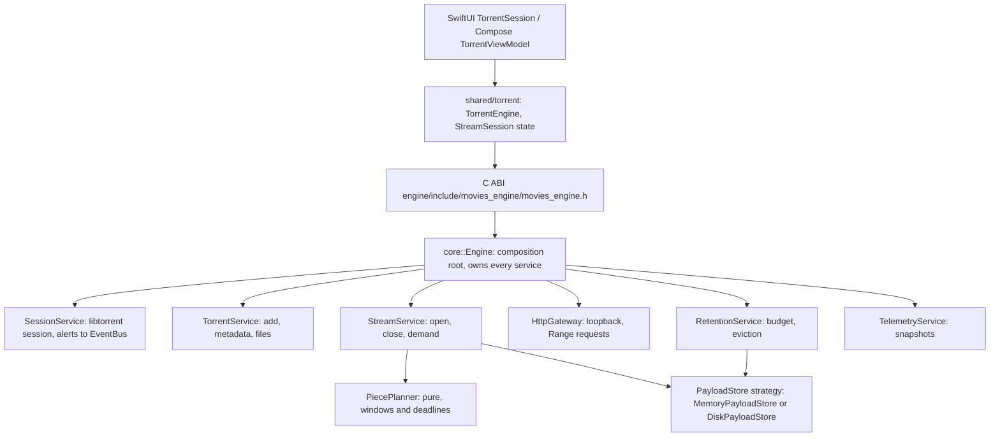

# Torrent engine rebuild

A new torrent streaming engine, written from scratch in `engine/`, replaces the NuvioMedia
`nuvio-engine`. Both TV apps reach it only through the Kotlin module `shared/torrent`. Since E7a
the Apple TV app links only the new engine and `engine/build.sh` with its patches is gone. Since E7
Android runs it too, through JNI (E6), and the prebuilt `nuvio-engine` AAR is deleted. Both apps
share one backend, `EngineTorrentBackend` in `shared/tv-api`.

## 1. Decisions

Settled:

- C++20 on libtorrent 2.0.12 and Boost 1.86 (headers only), both pinned by URL and SHA-256 in
  `engine/cmake/Dependencies.cmake`. No line comes from `nuvio-engine`: not its planners, not its
  13 libtorrent patches. A libtorrent patch we need is written here and kept in
  `engine/cmake/patches/`; the first one, `0001-drop-pieces.patch`, adds
  `torrent_handle::drop_pieces` so the memory store can free pieces (E1).
- The UI never calls the engine. SwiftUI and Compose call `shared/torrent`, which calls the C ABI.
- D1: the old patches also carried function, not only tuning (system trust store and CA bundle on
  Apple, route bounds on macOS). Each is rewritten only when a slice needs it. E1 checked HTTPS
  trackers: without TLS (D3) libtorrent skips them, and streams find peers through UDP trackers
  and DHT. The app adds five public UDP trackers to the ones the add-on sends.
- D2: one engine per build. From E1 to E7a the Gradle property `nuvio.tvos.engine` picked the
  old or the new one, since both bring their own libtorrent. E7a removed the switch with the old
  engine: `TvosTorrent` keeps its Swift facing API and `TvosTorrentBackend` in `tvosMain` runs the
  new engine.
- D4: the host may pass a memory budget through `movies_engine_config` (store cap, ahead,
  behind, eviction threshold; 0 keeps E1's default). The engine checks it at the edge (every value
  positive, ahead plus behind and the eviction threshold below the cap). tvOS passes none and keeps
  E1's 512 MiB; `budgetFor` in `shared/torrent` sizes it from free memory for Android (E6).
- D5: the Android library is built by `engine/scripts/build-android.sh` (`make engine-android`),
  the same CMake project as the tvOS slices, and not by AGP's `externalNativeBuild`: the Kotlin
  Multiplatform Android library plugin of AGP 9.2 has no `externalNativeBuild`, and a CMake run per
  Gradle variant would compile libtorrent again for debug and box. `shared/torrent` packages the
  result and fails the build when an ABI in `shared/local.properties` is missing, so no APK ships
  without the engine. One `libmovies_engine.so` per ABI holds the engine, libtorrent, `c++_static`
  and the JNI shim, and exports only the JNI functions.
- D6: Android runs the engine from RAM only, with `budgetFor` (D4) measured from
  `ActivityManager.MemoryInfo.availMem` when the engine opens: on the box a cap of at most
  192 MiB. The owner dropped the disk store (E5) for the box on 2026-11-24.
- The gateway url ends in `/video.<ext>` of the played file and answers with its media type
  (`video/mp4`, `video/x-matroska`, ...). AVPlayer refuses an extensionless url served as
  `application/octet-stream`, so the app picks AVPlayer for .mp4 and mpv for .mkv as it does for
  any other url.

Open (the default is what the plan assumes):

| # | Decision | Default |
|---|---|---|
| D3 | TLS in libtorrent (HTTPS trackers and web seeds) needs OpenSSL built for tvOS and armeabi-v7a | Without TLS (E1 ships this way), add it in E5 if a test addon needs it |

## 2. Acceptance criteria

| Id | Criterion |
|---|---|
| E-AC1 | A torrent plays on the Apple TV without writing its payload to flash |
| E-AC2 | A 4K remux of 80 to 90 GB plays without a stall when the swarm delivers more than its bitrate |
| E-AC3 | Seeking lands on the right bytes, and engine memory stays under a fixed cap through 20 seeks |
| E-AC4 | The UI reads stream state (resolving, buffering with percent, playing, stalled, failed) through `shared/torrent` |
| E-AC5 | Android TV plays a torrent with the same engine, from RAM within `budgetFor`'s cap (D6) |
| E-AC6 | Until E7 a build can still use the old engine (D2). Retired on tvOS by E7a, on Android by E7 |

T2 in `docs/android-tv-rebuild.md` reads 256 MiB ahead on tvOS since E7a (E1's window); E2 and
E3 size the window from memory.
On Android T2 reads half of `budgetFor`'s cap ahead, at most 96 MiB (E7). A10 (Android torrents)
runs on E6 since E7.

## 3. Architecture



- **Strategy**: `PayloadStore` has a memory and a disk implementation behind one interface.
  `PayloadDiskIo` adapts any of them to libtorrent's `disk_interface`, so libtorrent writes into
  the store and the HTTP gateway reads from it without a copy through libtorrent.
- **Composition root**: `core::Engine` builds every service from the config and injects them
  through constructors. No service creates another one or reaches for a global.
- **Functional core**: window, deadline, budget and eviction choices are pure functions with unit
  tests; services only carry them out.
- **Events, not callbacks**: libtorrent alerts become typed events on an internal bus, and the
  host polls them through the ABI.

### C ABI rules

- Every call returns a status and never throws or aborts. `movies_engine_last_error` holds the
  message of the last failed call on the calling thread.
- Fixed width types only: the box is 32-bit.
- The engine never calls into the host. Hosts poll.
- No size fields in structs: the app and the engine are built from the same commit.

### Folder structure

```
engine/
  CMakeLists.txt
  cmake/          Dependencies.cmake (pinned Boost and libtorrent), patches/ for libtorrent
  include/movies_engine/movies_engine.h   the only public header
  src/
    api/          C ABI facade
    core/         Engine (composition root), EngineConfig, EngineError
    session/      libtorrent session, settings, alerts as events
    torrent/      add and release torrents, file choice
    stream/       streams, readers, sequential window (planner in E2)
    http/         loopback gateway, Range requests
    storage/      PayloadStore, PayloadDiskIo, memory/ in E1, disk/ in E5
    retention/    E3
    telemetry/    E4
    android/      JNI shim for shared/torrent (E6): primitives and UTF-8 byte arrays only
  tests/          doctest unit and integration tests, support/ (loopback seeder, HTTP client)
  scripts/        tools.sh, test.sh, build-xcframework.sh, build-android.sh
shared/torrent/   Kotlin module: commonMain API and budgetFor, tvosMain cinterop, androidMain JNI
```

## 4. Slices

| Slice | Content | AC | Proof |
|---|---|---|---|
| E0 Skeleton | CMake project, `core::Engine`, C ABI (version, create, destroy, last error), doctest, xcframework, `shared/torrent` with cinterop, `make engine-test` in `make check` | none | `make engine-test`; `shared/torrent` tests on the tvOS simulator call the engine, including the failure path; `NuvioTvShared` links for device and simulator (the app strips the engine until E1 calls it) |
| E1 Play from RAM | libtorrent and Boost built for tvOS, SessionService, TorrentService, MemoryPayloadStore, StreamService with a plain sequential window, HttpGateway, D2 switch. Added in E1: a fixed 512 MiB store cap with eviction past 384 MiB, so a long film cannot fill memory before E3 | E-AC1, E-AC6 | Integration test: two libtorrent sessions on loopback, one seeds, the engine streams over HTTP and the bytes match. One film seen on the Apple TV |
| E2 Planner | Critical, playback and readahead windows, deadlines, seek | E-AC2, E-AC3 (seek) | Planner unit tests; integration test reads the right bytes after seeks |
| E3 Retention | Budget from `os_proc_available_memory()` in place of E1's fixed cap, eviction ordered by distance from the playhead | E-AC3 | 20 seeks stay under the cap in a test; on the device the footprint levels off |
| E4 State to UI | TelemetryService, `StreamSession` state machine in Kotlin, tvOS UI reads it | E-AC4 | Kotlin state machine tests; UI test sees progress on the stream row |
| E5 Disk store | Dropped for the box by the owner (D6): Android runs from RAM within `budgetFor`'s cap. Was: DiskPayloadStore for the 1.9 GB box | box | none |
| E6 Android | Memory budget in the C ABI (D4), `budgetFor` in `shared/torrent`, the engine cross built with the NDK for the box ABIs (armeabi-v7a, D5), JNI shim, `shared/torrent` Android target loading `libmovies_engine.so` | E-AC5 | `make engine-test` with a small cap test; `budgetFor` unit tests; a device test (open with a budget, bad budget, bad magnet, close) built into the `:torrent` test APK. A torrent plays on the box with E7 |
| E7a tvOS cutover | The Apple TV app links only the new engine; the D2 switch, `engine/build.sh`, its patches and the tvOS `nuvio-engine` sources go. Done ahead of E2 to E4 at the owner's request, so tvOS reads 256 MiB ahead from RAM and shows no peers or speed until E4 | E-AC1 | `make shared-test`, `make apple-tv-sim`, a film plays and seeks on the Apple TV |
| E7 Cutover | Android on the new engine (with E6 and A10) through `EngineTorrentBackend`, shared with tvOS; the `nuvio-engine` AAR, its Gradle and R8 wiring and core's Android `P2pStreamingEngine` (excluded, stubbed in the bridge) go; the row shows the step only until E4 | E-AC5, E-AC6 | `make check`, `make apple-tv-sim`, a film on the box |

## 5. Risks

| Risk | Handling |
|---|---|
| Streaming tuning of the old engine is lost | Compare both engines on the same film before E7 (D2 switch) |
| Weeks of work | The old engine kept playing until E7 |
| The box has 1.9 GB of RAM and a 32-bit address space | RAM only within `budgetFor`'s cap, at most 192 MiB (D6); the disk store was dropped |
| Native threads calling into Kotlin deadlock or crash | The ABI never calls back; hosts poll |
| Exceptions crossing `extern "C"` abort the app | Every ABI call runs inside one guard that maps exceptions to a status; tested |

## 6. How E1 streams

1. `movies_engine_open_stream` adds the magnet with every file at priority 0 and returns an id.
   The host polls `movies_engine_get_stream_info` until the stream is `READY` (metadata arrived,
   file chosen) and plays its `http://127.0.0.1:<port>/stream/<id>` url.
2. Until the player connects, the first 256 MiB of the file download. Each HTTP response is a
   reader: the 256 MiB ahead of every reader get priority, the first 4 pieces get deadlines, and
   everything else stays at 0.
3. A reader waits up to 60 s for its piece, then reads it straight from the memory store.
4. Past 384 MiB in the store, pieces outside every reader's range (32 MiB behind to 256 MiB ahead)
   are dropped through the `drop_pieces` patch: libtorrent forgets them, tells peers, and the
   store frees them, partial pieces included. No write may take the store past 512 MiB; one that
   would is refused and libtorrent drops that one peer.
5. `close_redundant_connections` is off: a stream often counts as finished (all wanted pieces
   held), and libtorrent would otherwise drop every seed at that moment.

## 7. Verified and not verified

Verified (E0): the toolchain builds tvOS device and simulator slices (`LC_BUILD_VERSION` platform
3 and 8, minimum tvOS 17.0); Kotlin/Native links the C++ library and its runtime.

Verified (E1, on a Mac and the tvOS simulator):

- libtorrent 2.0.12 and Boost 1.86 cross build for both tvOS slices from `engine/cmake`, with the
  patch applied; each slice is one archive with the engine and libtorrent.
- `make engine-test`: two libtorrent sessions on loopback. The engine streams a 3 MiB file over
  HTTP and the bytes match, whole and after two seeks; a file 4 times the store cap streams whole
  with the store under the cap. With eviction turned off the second test stalls and fails, so it
  does test eviction. libtorrent runs with its asserts on in this build.
- `shared/torrent` tests run on the tvOS simulator against the real engine (open, resolve, close,
  bad magnet) and against a scripted engine (polling, failure, timeout).
- `tvosShared` builds and its tests pass with both `nuvio.tvos.engine=legacy` and `next`; the
  `next` app (simulator and the signed Release device build) links `movies_engine_*` and none of
  the old engine's symbols, and the `legacy` app the reverse.
- In the tvOS simulator, the `next` app passes `testTorrentStreamPlaysThroughTheEngine`: the
  test add-on's Sintel torrent goes through `TvosTorrent`, the engine and the gateway, and mpv
  plays it.
- A real swarm, from a Mac through the C ABI (Sintel, 129 MB, magnet plus the app's UDP
  trackers, no TLS): metadata in 2 s, the whole file over HTTP plus two Range requests with
  matching bytes, ffmpeg decodes it without an error, and the state directory stays empty.

Verified (E7a, Debug build driven by a UI test on an Apple TV 4K): Big Buck Bunny 1080p (.mp4,
263 MB, Torrentio, 20 peers) plays in AVPlayer through the gateway, seeks forward by 30 presses
of the remote to 05:53, and plays on to 06:24 thirty seconds later without "Playback failed".
Before the media type fix AVPlayer refused the same stream with "Cannot Open".
Night of the Living Dead 2160p HEVC (.mkv, 4.35 GB, YTS, 45 peers) plays in mpv, seeks to 15:27
(about 680 MB into the file, past the 512 MiB cap, so eviction ran) and plays on to 16:05 forty
five seconds later. A 15.77 GB .mkv with 5 peers found no metadata in 90 s (weak swarm; HTTPS
trackers need D3).

Verified (E6, on a Mac; nothing run on a device yet):

- NDK 29.0.14206865 cross builds libtorrent 2.0.12, Boost 1.86 and the engine for armeabi-v7a
  (API 24, `c++_static`, Release) with `-Werror` and the drop-pieces patch, at the first attempt.
  `libmovies_engine.so` is a 32-bit ARM ELF of 2.1 MB stripped (the old AAR's armeabi-v7a library
  is 7.5 MB with OpenSSL), needs only libc, libm and libdl, and exports only the six JNI functions.
- `make engine-test`: the budget checks, the C ABI refusing a budget that does not fit, and a
  loopback stream with a cap 16 pieces wide at `budgetFor`'s ratios that reads whole and after
  three seeks with the store under the cap.
- The `:torrent` device test APK and AAR carry `lib/armeabi-v7a/libmovies_engine.so`; without the
  library the Android build stops with "Build it first: make engine-android".

Not verified:
`os_proc_available_memory()` on an Apple TV 4K; eviction against a real swarm (Sintel is under
the cap; the loopback test covers it); a long film and seeks in mpv through the gateway (one
connection per seek, `Connection: close`). Memory on the device: the store holds up to 512 MiB
and mpv's demuxer up to 250 MiB on top of it.
