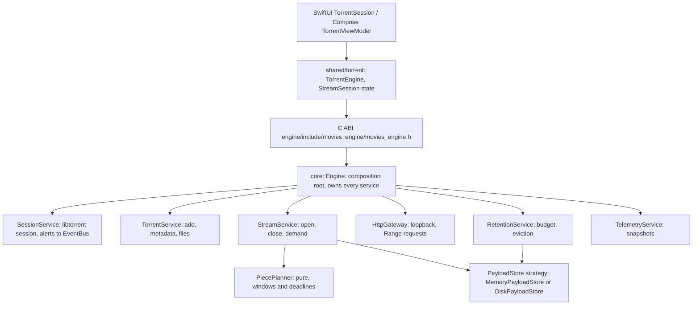

# Torrent engine rebuild

A new torrent streaming engine, written from scratch in `engine/`, replaces the NuvioMedia
`nuvio-engine` that `engine/build.sh` builds from a pinned upstream commit. Both TV apps reach it
only through the Kotlin module `shared/torrent`. Until slice E7 the old engine stays the one the
apps use, so `main` always plays torrents.

## 1. Decisions

Settled:

- C++20 on libtorrent 2.0.12. No line comes from `nuvio-engine`: not its planners, not its 13
  libtorrent patches. A libtorrent patch we need (for example to evict a piece in E3) is written
  here and kept in `engine/cmake/patches/`.
- The UI never calls the engine. SwiftUI and Compose call `shared/torrent`, which calls the C ABI.
- D1: the old patches also carried function, not only tuning (system trust store and CA bundle on
  Apple, route bounds on macOS). Each is rewritten only when a slice needs it; E1 checks HTTPS
  trackers.
- D2: one engine per build. The old static library exports about 11,000 libtorrent symbols and
  the new one brings its own copy, so the Gradle property `nuvio.tvos.engine=legacy` or `next`
  picks which one is linked. `legacy` is the default until E7.

Open (the default is what the plan assumes):

| # | Decision | Default |
|---|---|---|
| D3 | TLS in libtorrent (HTTPS trackers and web seeds) needs OpenSSL built for tvOS and armeabi-v7a | Without TLS in E1, add it in E5 if a test addon needs it |

## 2. Acceptance criteria

| Id | Criterion |
|---|---|
| E-AC1 | A torrent plays on the Apple TV without writing its payload to flash |
| E-AC2 | A 4K remux of 80 to 90 GB plays without a stall when the swarm delivers more than its bitrate |
| E-AC3 | Seeking lands on the right bytes, and engine memory stays under a fixed cap through 20 seeks |
| E-AC4 | The UI reads stream state (resolving, buffering with percent, playing, stalled, failed) through `shared/torrent` |
| E-AC5 | Android TV plays a torrent with the same engine |
| E-AC6 | Until E7 a build can still use the old engine (D2) |

T2 in `docs/android-tv-rebuild.md` (1 GiB readahead on the old engine) stays valid until E7.
A10 (Android torrents) builds on E6.

## 3. Architecture



- **Strategy**: `PayloadStore` has a memory and a disk implementation behind one interface, and
  libtorrent sees it as its `disk_interface`.
- **Composition root**: `core::Engine` builds every service from the config and injects them
  through constructors. No service creates another one or reaches for a global.
- **Functional core**: window, deadline, budget and eviction choices are pure functions with unit
  tests; services only carry them out.
- **Events, not callbacks**: libtorrent alerts become typed events on an internal bus, and the
  host polls them through the ABI.

### C ABI rules

- Every call returns a status and never throws or aborts. `movies_engine_last_error` holds the
  message of the last failed call on the calling thread.
- Fixed width types only: the box is 32-bit.
- The engine never calls into the host. Hosts poll.
- No size fields in structs: the app and the engine are built from the same commit.

### Folder structure

```
engine/
  CMakeLists.txt
  include/movies_engine/movies_engine.h   the only public header
  src/
    api/          C ABI facade
    core/         Engine (composition root), EngineConfig, EngineError
    session/      E1
    torrent/      E1
    stream/       E1, planner in E2
    http/         E1
    storage/      memory/ in E1, disk/ in E5
    retention/    E3
    telemetry/    E4
  tests/          doctest unit and integration tests
  scripts/        tools.sh, test.sh, build-xcframework.sh
shared/torrent/   Kotlin module: commonMain API, tvosMain cinterop, androidMain JNI in E6
```

## 4. Slices

| Slice | Content | AC | Proof |
|---|---|---|---|
| E0 Skeleton | CMake project, `core::Engine`, C ABI (version, create, destroy, last error), doctest, xcframework, `shared/torrent` with cinterop, `make engine-test` in `make check` | none | `make engine-test`; `shared/torrent` tests on the tvOS simulator call the engine, including the failure path; `NuvioTvShared` links for device and simulator (the app strips the engine until E1 calls it) |
| E1 Play from RAM | libtorrent and Boost built for tvOS, SessionService, TorrentService, MemoryPayloadStore, StreamService with a plain sequential window, HttpGateway, D2 switch | E-AC1, E-AC6 | Integration test: two libtorrent sessions on loopback, one seeds, the engine streams over HTTP and the bytes match. One film seen on the Apple TV |
| E2 Planner | Critical, playback and readahead windows, deadlines, seek | E-AC2, E-AC3 (seek) | Planner unit tests; integration test reads the right bytes after seeks |
| E3 Retention | Budget from `os_proc_available_memory()`, hard byte cap that counts partial pieces, eviction | E-AC3 | 20 seeks stay under the cap in a test; on the device the footprint levels off |
| E4 State to UI | TelemetryService, `StreamSession` state machine in Kotlin, tvOS UI reads it | E-AC4 | Kotlin state machine tests; UI test sees progress on the stream row |
| E5 Disk store | DiskPayloadStore for the 1.9 GB box | box | The E1 to E3 integration tests pass with the disk store |
| E6 Android | JNI binding, AAR built from this source, armeabi-v7a | E-AC5 | A torrent plays on the box (with A10) |
| E7 Cutover | New engine is the default, `nuvio-engine`, `engine/build.sh` and its patches go | all | `make check`, `make apple-tv-sim`, a film on the Apple TV and on the box |

## 5. Risks

| Risk | Handling |
|---|---|
| Streaming tuning of the old engine is lost | Compare both engines on the same film before E7 (D2 switch) |
| Weeks of work | The old engine keeps playing until E7 |
| The box has 1.9 GB of RAM and a 32-bit address space | E5 disk store; RAM mode only where the budget allows |
| Native threads calling into Kotlin deadlock or crash | The ABI never calls back; hosts poll |
| Exceptions crossing `extern "C"` abort the app | Every ABI call runs inside one guard that maps exceptions to a status; tested |

## 6. Verified and not verified

Verified: the E0 toolchain builds tvOS device and simulator slices (`LC_BUILD_VERSION` platform 3
and 8, minimum tvOS 17.0). Kotlin/Native links the C++ library and its runtime with no extra
linker options: in the simulator test binary, where the tests run, and in the device release
framework (`linkReleaseFrameworkTvosArm64`), which was linked but not run.

Not verified: `os_proc_available_memory()` on an Apple TV 4K; libtorrent's `disk_interface` beyond
its `examples/custom_storage.cpp`; libtorrent and Boost cross builds for tvOS without the old
scripts (first task of E1).
